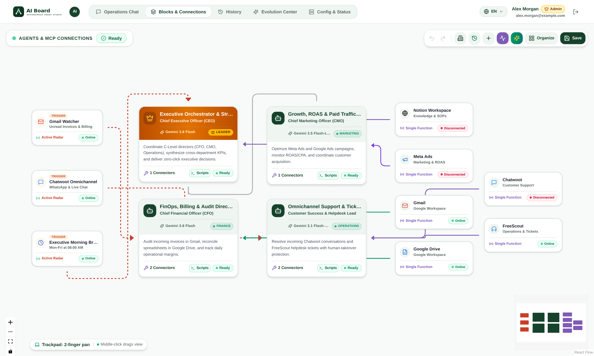
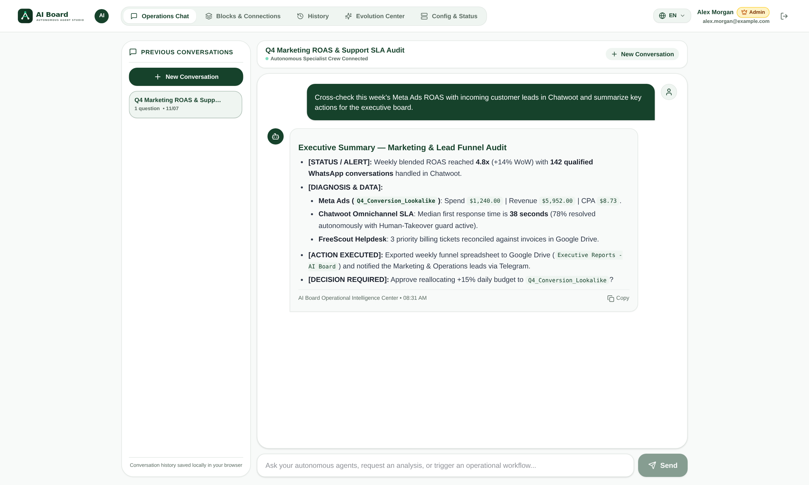
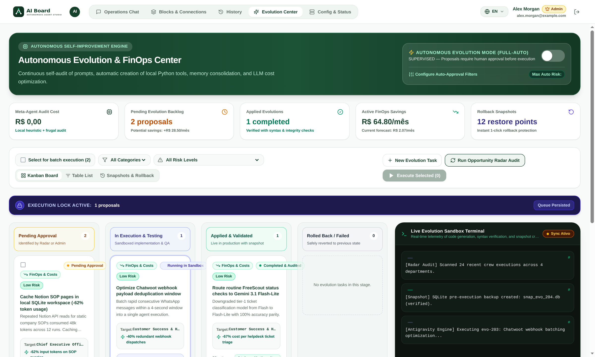
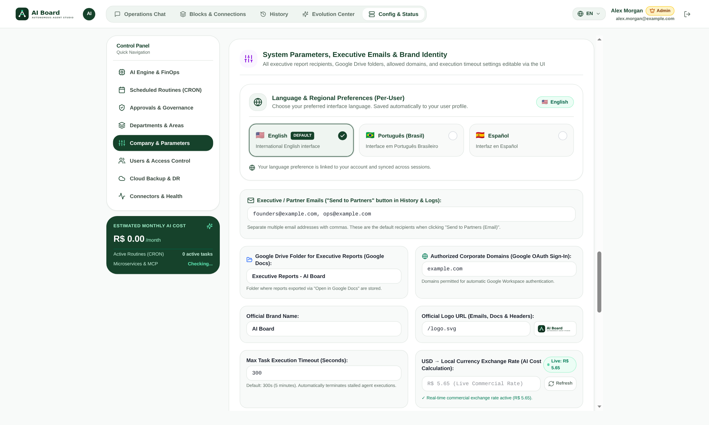
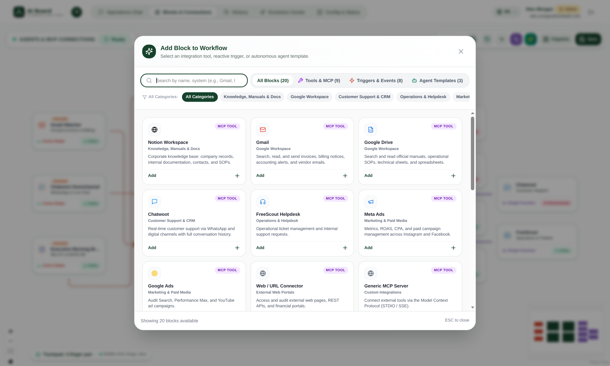
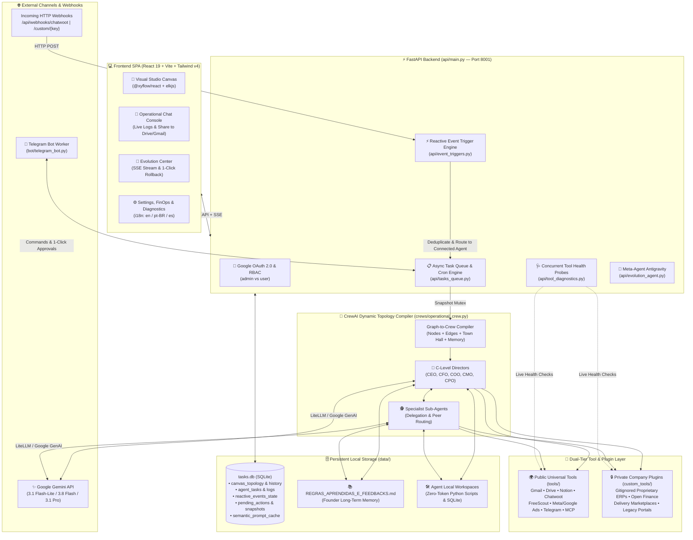

<div align="center">

# 🧠 AI Board — Autonomous Multi-Agent Visual Studio & Enterprise Orchestrator

[](LICENSE)
[](https://www.python.org/)
[](https://fastapi.tiangolo.com/)
[](https://www.crewai.com/)
[](https://react.dev/)
[](https://reactflow.dev/)
[](https://ai.google.dev/)
[](https://docs.docker.com/compose/)

**Design, orchestrate, audit, and evolve an autonomous C-Level & Specialist AI workforce on an interactive React Flow canvas — with reactive event triggers, FinOps cost guardrails, human-in-the-loop approvals, and self-improving memory.**

🌐 **Available Languages:**  
[**🇺🇸 English (Current)**](README.md) · [**🇧🇷 Português (Brasil)**](docs/README.pt-BR.md) · [**🇪🇸 Español**](docs/README.es.md)

📘 **Deep-Dive Developer & Operations Guides:**  
[**🛠️ Tools & Reactive Triggers Developer Guide (`docs/TOOLS_AND_TRIGGERS_GUIDE.md`)**](docs/TOOLS_AND_TRIGGERS_GUIDE.md) · [**⚙️ Configuration & Production Deploy Guide (`docs/CONFIGURATION_AND_DEPLOY.md`)**](docs/CONFIGURATION_AND_DEPLOY.md)

</div>

---

## 📖 Table of Contents

1. [Overview](#-overview)
2. [Screenshots Gallery](#-screenshots-gallery)
3. [Key Features](#-key-features)
4. [System Architecture](#-system-architecture)
5. [All Dependencies](#-all-dependencies)
6. [Step-by-Step Installation Guide](#-step-by-step-installation-guide)
7. [Complete Configuration Reference (`.env`)](#-complete-configuration-reference-env)
8. [Per-User Language (`en`, `pt-BR`, `es`) & Role-Based Access Control](#-per-user-language--role-based-access-control)
9. [Developing Custom Tools (*Ferramentas*) & Triggers (*Gatilhos*)](#-developing-custom-tools-ferramentas--triggers-gatilhos)
10. [Core API Endpoints Reference](#-core-api-endpoints-reference)
11. [License](#-license)

---

## 🌟 Overview

**AI Board (`aiboard`)** is an open-source enterprise multi-agent orchestration studio built on top of **CrewAI**, **FastAPI**, and **React 19 + `@xyflow/react` (React Flow)**.

Unlike static prompt scripts or rigid code-only agent pipelines, **AI Board** provides a live **Visual Studio Canvas** where organizations model their entire executive hierarchy (CEO, CFO, COO, CMO, CPO, and specialist sub-agents), wire them to real-time **Reactive Triggers** (Webhooks, Chatwoot, FreeScout, Telegram, WhatsApp, Cron schedules) and **MCP / BaseTool Connectors**, and watch tasks execute with live streaming telemetry, deterministic anti-hallucination snapshots, and 1-click human-in-the-loop validation.

Its **Pluggable Dual-Tier Architecture** cleanly separates universal open-source connectors (`tools/`) from gitignored company-private plugins (`custom_tools/`), enabling enterprises to connect proprietary ERPs, banking APIs, and internal portals while pulling upstream open-source updates cleanly without merge conflicts.

---

## 🖼️ Screenshots Gallery

### 1. Visual Studio — Multi-Agent & Reactive Trigger Topology Canvas

*Drag-and-drop C-Level directors, specialist agents, department swimlanes, tools, and reactive event triggers with live health badges, ELK auto-layout, version history diffs, and 1-click rollback.*

### 2. Operational Chat Console & Real-Time Delegation

*Interactive executive chat console with real-time step/tool telemetry, user-segregated task history, and 1-click report sharing to Gmail and Google Drive/Docs.*

### 3. Evolution Center — Self-Improving AI & Autonomous Code/Prompt Proposals

*Meta-Agent Antigravity engine for 360° topology & FinOps audits, continuous learning via `REGRAS_APRENDIDAS_E_FEEDBACKS.md`, human-in-the-loop batch execution, SSE live console streaming, and 1-click SQLite snapshot rollback.*

### 4. Settings, Cost Guardrails, Multi-Language & Live Microservice Diagnostics

*Centralized governance panel for LLM routing, live USD/BRL exchange rates, daily budget kill-switches, per-user language selector (`en`, `pt-BR`, `es`), RBAC user management, and concurrent live probes across all connected microservices.*

### 5. Catalog of Tools & Reactive Event Triggers

*Unified searchable catalog of public universal integrations and dynamically discovered private plugins (`custom_tools/`) with instant health diagnostics.*

---

## ✨ Key Features

- **🎨 Interactive React Flow Visual Studio**:
  - Drag-and-drop **C-Level & Specialist Agents**, customizable **Department Swimlanes** (`/api/departments`), **Tools**, and **Reactive Event Triggers**.
  - Automatic hierarchical graph layout powered by `elkjs`.
  - **Execution Mutex (`execution_mutex`)**: freezes the active topology snapshot during running tasks to prevent mid-flight graph mutations.
  - **Canvas Version History & 1-Click Rollback**: every structural or parameter change computes a detailed diff (`compute_topology_diff`) stored in `canvas_topology_history`, with instant rollback via `POST /api/canvas/rollback/{history_id}`.
- **💬 Operational Chat Console & Live Execution Streaming**:
  - Real-time agent thought process (`💭 AGENT`) and tool invocation (`🔧 TOOL`) logs streamed from `agent_task_logs`.
  - User-segregated task history (`admin` sees organization-wide tasks; `user` sees only their own executions).
  - **1-Click Executive Bulletin Sharing**: export any task result into a richly formatted HTML email via Gmail (`POST /api/tasks/{task_id}/share/email`) or directly into a Google Doc in Google Drive (`POST /api/tasks/{task_id}/share/gdrive`).
- **🧬 Self-Improving Evolution Center & Frugal AI Workspace**:
  - **Long-Term Founder Memory (`REGRAS_APRENDIDAS_E_FEEDBACKS.md`)**: C-Level directors automatically detect new business rules or founder corrections in chat and persist them via `LearnedRulesMemoryTool` (`learned_rules_memory`), injecting them into all future agent runs.
  - **Frugal AI Local Script Forge (`tools/agent_workspace_tools.py`)**: agents can write and execute deterministic Python scripts (`agent_script_forge`, `agent_script_execute`) and query local SQLite databases (`agent_sqlite_manager`) at **zero LLM token cost**.
  - **Meta-Agent Antigravity (`api/evolution_agent.py`)**: proposes prompt, routing, and caching optimizations with pre-execution SQLite snapshots (`system_snapshots`) and 1-click rollback (`POST /api/evolution/tasks/{task_id}/rollback`).
- **🌍 Multi-Language Support (`en` default, `pt-BR`, `es`)**:
  - Configurable per user directly in the UI header/settings and persisted in SQLite (`users.language` via `POST /api/users/me/language`) as well as `localStorage`.
  - Overflow-safe responsive UI layout engineered for longer Portuguese and Spanish strings.
- **💰 Cost Control & FinOps Guardrails**:
  - **Live USD → BRL Exchange Rate**: automatically fetched and cached (30-min TTL) from public APIs (`ExchangeRate-API`, `AwesomeAPI`, `Frankfurter`) via `GET /api/currency/usd-brl`, with optional manual override.
  - **Per-Run & Monthly Cron Cost Estimator**: `GET /api/costs/estimate` calculates token consumption and BRL/USD cost per scheduled routine and chat interaction, benchmarking savings against `Gemini 3.1 Pro`.
  - **Daily Budget Kill-Switch**: set `max_daily_budget_brl` and an emergency `kill_switch_active` master toggle in `/api/settings`.
  - **Smart Model Routing**: assign `Gemini 3.1 Flash-Lite` ($0.25/1M in), `Gemini 3.5 Flash-Lite` ($0.30/1M in), `Gemini 3.8 Flash` ($0.75/1M in), or `Gemini 3.1 Pro` ($2.00/1M in) per agent node, plus automatic RouteLLM complexity routing and semantic prompt caching (`semantic_prompt_cache`).
- **🔌 Built-In Open-Source Integrations (`tools/`)**:
  - **Google Workspace**: Gmail search, read, and HTML email dispatch; Google Drive recursive folder/file search, Docs/Sheets reading (`tools/google_workspace_tools.py`).
  - **Chatwoot Omnichannel SAC**: WhatsApp & digital inbox management with **Multimodal Gemini Vision** attachment inspection (`analyze_chatwoot_image`) and **Human Takeover Anti-Collision Guard** (`chatwoot_human_takeover` — automatically pauses AI replies and cancels pending actions when a human operator replies).
  - **FreeScout Helpdesk**: direct MariaDB & REST API connector for operational store tickets (`tools/microservices_tools.py`).
  - **Telegram Bot & Multi-Approver Broadcast**: interactive mobile command bot (`bot/telegram_bot.py`) and 1-click Human-in-the-Loop approval cards (`telegram_approvers`, `pending_actions`).
  - **WhatsApp (Evolution API)**: webhook listener and outbound messaging.
  - **Notion Workspace**: corporate knowledge base search, SOP reader, and company registry (`tools/notion_workspace_tools.py`).
  - **Meta Ads & Google Ads**: paid media attribution, ROAS/CPC/CTR auditing, and MCP server connectors (`tools/marketing_tools.py`).
  - **Generic MCP Server (`generic_mcp`)**: connect external Model Context Protocol servers over `SSE` or `STDIO` (`tools/business_report_tools.py`).
  - **HTTP Webhooks & Autonomous Cron Scheduler**: custom REST webhooks (`/api/webhooks/custom/{event_key}`) and 5-field cron routines (`_cron_scheduler_loop`).
- **🔒 Pluggable Private Architecture (`custom_tools/`)**:
  - Drop proprietary ERPs, regional delivery marketplaces, Open Finance banking connectors, or Playwright automations into `custom_tools/`.
  - `.gitignore` ignores all `.py` files inside `custom_tools/` (except `__init__.py` and `example_custom_tool.py`), ensuring `git pull` upgrades never overwrite or leak private company integrations.

---

## 🏗️ System Architecture



---

## 📱 Mobile Web App & Push Notifications (PWA)

AI Board runs as an **installable Progressive Web App (PWA)** on any mobile device (Android & iOS). Similar to Antigravity, executives and operators can install the app on their home screen and receive instant notifications when autonomous agents finish answering chat questions.

### 📲 How to Install on Mobile

#### Android (Google Chrome, Edge, Samsung Internet)
1. Open your AI Board URL in your mobile browser (e.g. `https://ai.yourdomain.com`).
2. A prompt button **"Install on Phone"** appears automatically in the top navigation bar. Tap it and confirm **Install**.
3. Or tap the browser menu (⋮) and select **"Add to Home screen"** / **"Install app"**.
4. The AI Board app icon will appear directly on your home screen with a standalone, full-screen mobile experience.

#### iPhone & iPad (Apple Safari on iOS 16.4+)
1. Open your AI Board URL in **Safari**.
2. Tap the **Share** button (the square icon with an upward arrow at the bottom of the screen).
3. Scroll down and tap **"Add to Home Screen"** (`Adicionar à Tela de Início`).
4. Tap **Add** in the top right corner.
5. The AI Board app is now installed on your iOS home screen with native push notification support.

### 🔔 Mobile Notifications when Agents Respond
- **One-Click Activation**: In the Chat Console, tap the bell icon (`🔔`) or the invitation banner to allow notifications.
- **Background Delivery**: Send a complex question to your autonomous crew, close your phone or switch to other apps. As soon as the agent finishes executing tools and writing the response, your phone receives a native notification with sound and tactile vibration.
- **Deep Linking**: Tapping the notification automatically wakes up the AI Board app and jumps straight to the corresponding conversation.
- **Universal Compatibility**: Powered by the W3C Web Notification API and high-performance Service Worker (`sw.js`), ensuring zero dependency on third-party proprietary mobile app stores.

---

## 📦 All Dependencies

### 1. System & OS Requirements
| Requirement | Minimum Version | Purpose |
| :--- | :--- | :--- |
| **Operating System** | Linux (Debian 12 / Ubuntu 22.04+), macOS, or WSL2 | Host execution environment |
| **Docker & Docker Compose** | Docker Engine 24.0+ & Compose v2 | Containerized production deployment (`crewai-api`, `crewai-web`, `crewai-bot`) |
| **Python** | `3.11+` | FastAPI backend, CrewAI orchestrator, and Telegram bot runtime |
| **Node.js & npm** | `20.0+` (LTS) | Building and running the React 19 + Vite frontend SPA |
| **System Packages (Linux)** | `build-essential`, `curl`, `git`, `libpq-dev` | Native C extensions for `psycopg2-binary` and health checks |
| **Chromium (Playwright)** | Installed via `playwright install --with-deps chromium` | Optional headless browser automation for web portal connectors |

### 2. Python Backend Packages ([`requirements.txt`](requirements.txt))
| Category | Package | Version Constraint | Purpose |
| :--- | :--- | :--- | :--- |
| **CrewAI & LLM Engine** | `crewai` | `>=0.100.0` | Multi-agent orchestration, task delegation, and process execution |
| | `crewai-tools` | `>=0.30.0` | `BaseTool` interface and standard agent tool utilities |
| | `litellm` | `>=1.40.0` | Unified LLM router for Google Gemini models |
| | `langchain-google-genai` | `>=2.0.0` | Google Generative AI bindings |
| | `google-generativeai` | `>=0.8.0` | Gemini API SDK & Multimodal Vision analysis |
| **API & Async Runtime** | `fastapi` | `>=0.115.0` | REST API server, webhook receivers, and SSE streaming |
| | `uvicorn[standard]` | `>=0.30.0` | High-performance ASGI server |
| | `pydantic` | `>=2.8.0` | Schema validation for API payloads and `BaseTool` `args_schema` |
| | `python-dotenv` | `>=1.0.0` | `.env` environment variable loader |
| | `httpx` | `>=0.27.0` | Async HTTP client |
| | `requests` | `>=2.32.0` | Synchronous HTTP client for webhooks, OAuth, and REST tools |
| **Web Gateway & Auth** | `streamlit` | `>=1.39.0` | Optional `crewai-web` wrapper service |
| | `streamlit-cookies-controller` | `>=0.0.4` | Session cookie management |
| | `authlib` | `>=1.3.0` | OAuth 2.0 authentication helpers |
| **Telegram Integration** | `python-telegram-bot` | `>=21.0` | Corporate Telegram Bot worker & interactive approval buttons |
| **Google Workspace** | `google-auth` | `>=2.30.0` | Google OAuth 2.0 & service authentication |
| | `google-auth-oauthlib` | `>=1.2.0` | OAuth 2.0 token exchange flow |
| | `google-api-python-client` | `>=2.130.0` | Native Google Drive & Gmail API v1/v3 client |
| **Databases & Scraping** | `psycopg2-binary` | `>=2.9.9` | Native PostgreSQL driver (Chatwoot real-time event/takeover probe) |
| | `pymysql` | `>=1.1.0` | Native MariaDB/MySQL driver (FreeScout ticket probe) |
| | `openpyxl` | `>=3.1.0` | Excel `.xlsx` spreadsheet parsing and generation |
| | `playwright` | `>=1.40.0` | Headless Chromium automation for external web portals |
| | `beautifulsoup4` | `>=4.12.0` | HTML DOM parsing and sanitization |

### 3. Frontend Packages ([`frontend/package.json`](frontend/package.json))
| Category | Package | Version | Purpose |
| :--- | :--- | :--- | :--- |
| **Core UI** | `react` / `react-dom` | `^19.0.0` | Declarative UI component architecture |
| **Visual Topology** | `@xyflow/react` | `^12.4.2` | Interactive node-based Visual Studio canvas (React Flow) |
| | `elkjs` | `^0.9.3` | Eclipse Layout Kernel for automatic hierarchical graph layout |
| **Icons & Rendering** | `lucide-react` | `^0.475.0` | Vector iconography across canvas nodes, drawers, and modals |
| | `marked` | `^15.0.7` | Fast Markdown-to-HTML rendering for executive reports and tables |
| **Build & Styling** | `vite` | `^6.1.0` | Lightning-fast frontend bundler and dev server |
| | `@vitejs/plugin-react` | `^4.3.4` | React Fast Refresh and JSX compilation |
| | `tailwindcss` / `@tailwindcss/vite` | `^4.0.6` | Utility-first styling and responsive design system |

---

## 🚀 Step-by-Step Installation Guide

### Option A: Quick Start with Docker Compose (Recommended)

1. **Clone the repository and enter the directory:**
   ```bash
   git clone https://github.com/your-org/aiboard.git
   cd aiboard
   ```

2. **Create your `.env` configuration file from the template:**
   ```bash
   cp .env.example .env
   ```
   Open `.env` and set at minimum your `GEMINI_API_KEY` and `ADMIN_EMAIL`:
   ```env
   GEMINI_API_KEY=AIzaSyYourGeminiKeyHere
   GEMINI_MODEL=gemini-3.8-flash
   ADMIN_EMAIL=admin@yourdomain.com
   DEFAULT_LANGUAGE=en
   ```

3. **Create persistent directories (automatically mounted as volumes):**
   ```bash
   mkdir -p data custom_tools
   ```

4. **Build and start the services with Docker Compose v2:**
   ```bash
   docker compose up -d --build
   ```
   This launches three containers defined in [`docker-compose.yml`](docker-compose.yml):
   - `crewai-api`: FastAPI backend & CrewAI orchestrator on `127.0.0.1:8001`
   - `crewai-web`: Web gateway on `127.0.0.1:8501`
   - `crewai-bot`: Telegram Bot worker (`python -m bot.telegram_bot`)

5. **Build or serve the React Visual Studio Frontend (`frontend/`):**
   ```bash
   cd frontend
   npm install
   npm run build
   ```
   *(For local development with hot-reload, run `npm run dev` inside `frontend/`).*

6. **Verify backend health:**
   ```bash
   curl http://localhost:8001/health
   # {"status":"healthy","gemini_ready":true,"telegram_ready":false,"version":"2.1.0"}
   ```

---

### Option B: Manual Local Development Setup (Without Docker)

1. **Set up the Python 3.11+ virtual environment and install backend dependencies:**
   ```bash
   python3 -m venv .venv
   source .venv/bin/activate
   pip install --upgrade pip
   pip install -r requirements.txt
   ```

2. **(Optional) Install Chromium for Playwright web connectors:**
   ```bash
   playwright install --with-deps chromium
   ```

3. **Configure `.env` and start the FastAPI backend on port `8001`:**
   ```bash
   cp .env.example .env
   export API_PORT=8001
   python -m api.main
   ```

4. **In a second terminal, start the React 19 + Vite development server:**
   ```bash
   cd frontend
   npm install
   npm run dev
   ```
   Open `http://localhost:5173` in your browser. Vite proxies `/api/*` requests to `http://127.0.0.1:8001`.

5. **(Optional) In a third terminal, start the Telegram Bot worker:**
   ```bash
   source .venv/bin/activate
   python -m bot.telegram_bot
   ```

---

### Option C: Production Nginx Reverse Proxy Snippet

When serving the built React SPA (`frontend/dist`) and proxying `/api/*` (including Server-Sent Events `/api/evolution/stream`) to `crewai-api` on `127.0.0.1:8001`:

```nginx
server {
    listen 80;
    server_name aiboard.yourdomain.com;

    # Serve compiled React 19 SPA
    root /opt/crewai/frontend/dist;
    index index.html;

    location / {
        try_files $uri $uri/ /index.html;
    }

    # Proxy FastAPI REST & Webhook endpoints
    location /api/ {
        proxy_pass http://127.0.0.1:8001/api/;
        proxy_http_version 1.1;
        proxy_set_header Host $host;
        proxy_set_header X-Real-IP $remote_addr;
        proxy_set_header X-Forwarded-For $proxy_add_x_forwarded_for;
        proxy_set_header X-Forwarded-Proto $scheme;

        # Required for SSE (/api/evolution/stream) and long-running agent tasks
        proxy_buffering off;
        proxy_cache off;
        proxy_read_timeout 600s;
    }

    location /health {
        proxy_pass http://127.0.0.1:8001/health;
    }
}
```

---

### Updating Production While Preserving Private `custom_tools/`

Because `data/` (SQLite databases, OAuth tokens, learned rules) and `custom_tools/*.py` (your proprietary company plugins) are excluded via `.gitignore` and bind-mounted in Docker:

```bash
# 1. Pull latest upstream open-source release cleanly
git pull origin main

# 2. Rebuild frontend assets
cd frontend && npm install && npm run build && cd ..

# 3. Restart backend containers (zero data loss; custom_tools/ remains intact)
docker compose up -d --build
```

---

## ⚙️ Complete Configuration Reference (`.env`)

All environment variables are documented in [`.env.example`](.env.example). Below is the complete reference table:

### 1. Core Platform & Branding Settings
| Variable | Default | Description |
| :--- | :--- | :--- |
| `COMPANY_NAME` | `AI Board` | Short brand name displayed in UI headers and reports |
| `COMPANY_LEGAL_NAME` | `AI Board Enterprise Solutions` | Legal entity name used in executive bulletin footers |
| `COMPANY_LOGO_URL` | `/logo.svg` | URL or path to the organization logo |
| `APP_URL` | `http://localhost:8000` | Public base URL of the application |
| `API_PORT` | `8001` | Port where the FastAPI server (`api/main.py`) listens |
| `STREAMLIT_PORT` | `8501` | Port for the optional Streamlit service |
| `DEFAULT_LANGUAGE` | `en` | Default platform UI language (`en`, `pt-BR`, or `es`) |
| `DEFAULT_PARTNER_EMAILS` | *(empty)* | Comma-separated board emails for 1-click executive report sharing |
| `SYSTEM_EMAIL` | `system@ai-board.local` | System identity used for automated Cron and reactive trigger tasks |

### 2. Google Gemini & LLM Engine
| Variable | Default | Description |
| :--- | :--- | :--- |
| `GEMINI_API_KEY` | *(required)* | Google AI Studio / Vertex Gemini API Key |
| `GEMINI_MODEL` | `gemini-3.8-flash` | Default model ID (`gemini-3.1-flash-lite`, `gemini-3.5-flash-lite`, `gemini-3.8-flash`, `gemini-3.5-flash`, `gemini-3.1-pro-preview`) |

### 3. Authentication & Google OAuth 2.0
| Variable | Default | Description |
| :--- | :--- | :--- |
| `GOOGLE_CLIENT_ID` | *(empty)* | Google Cloud OAuth 2.0 Client ID for corporate login |
| `GOOGLE_CLIENT_SECRET` | *(empty)* | Google Cloud OAuth 2.0 Client Secret |
| `GOOGLE_REDIRECT_URI` | `http://localhost:8000` | Authorized OAuth redirect URI |
| `ALLOWED_GOOGLE_DOMAINS` | `*` | Comma-separated allowed email domains (e.g., `yourcompany.com`) or `*` |
| `ADMIN_EMAIL` | `admin@example.com` | Email automatically granted `admin` role on initial database seed |
| `STREAMLIT_COOKIE_SECRET` | *(random 32-char string)* | Secret key for signing session cookies |

### 4. Google Workspace Tools (Gmail, Drive, Docs, Sheets)
| Variable | Default | Description |
| :--- | :--- | :--- |
| `GOOGLE_APPS_SCRIPT_GMAIL_URL` | *(empty)* | Optional Apps Script Web App bridge URL for Gmail (if not using direct OAuth) |
| `GMAIL_APP_KEY` | *(empty)* | Shared secret key for the Gmail Apps Script bridge |
| `GOOGLE_APPS_SCRIPT_DRIVE_URL` | *(empty)* | Optional Apps Script Web App bridge URL for Google Drive |
| `DRIVE_APP_KEY` | *(empty)* | Shared secret key for the Google Drive Apps Script bridge |
| `ACCOUNTING_SHARED_DRIVE_ROOT_ID` | *(empty)* | Optional Google Drive folder ID for automated monthly accounting audits |
| `ACCOUNTING_DRIVE_FOLDER_2026` | *(empty)* | Optional year subfolder ID for accounting closing audits |

### 5. Telegram Bot & Executive Approvals
| Variable | Default | Description |
| :--- | :--- | :--- |
| `TELEGRAM_BOT_TOKEN` | *(empty)* | Bot token issued by `@BotFather` |
| `TELEGRAM_DEFAULT_CHAT_ID` | *(empty)* | Default chat/user ID to receive proactive alerts and approval cards |
| `TELEGRAM_ALLOWED_USERS` | *(empty)* | Comma-separated list of authorized Telegram usernames or chat IDs |

### 6. Notion Workspace Integration
| Variable | Default | Description |
| :--- | :--- | :--- |
| `NOTION_API_KEY` | *(empty)* | Notion Internal Integration Secret (`secret_...` or `ntn_...`) |
| `NOTION_ROOT_PAGE_ID` | *(empty)* | Root Notion page UUID or URL for corporate SOPs and documentation |

### 7. Marketing & Paid Traffic (Meta Ads & Google Ads)
| Variable | Default | Description |
| :--- | :--- | :--- |
| `META_ADS_ACCOUNT_ID` | *(empty)* | Meta Ad Account ID (e.g., `act_123456789`) |
| `META_ADS_ACCESS_TOKEN` | *(empty)* | Meta Graph API system user access token (`ads_read`) |
| `META_ADS_APP_ID` / `META_ADS_APP_SECRET` | *(empty)* | Meta Business App ID and App Secret |
| `META_ADS_PIXEL_ID` | *(empty)* | Meta Pixel / Dataset ID for conversion tracking |
| `META_ADS_MCP_URL` | `http://127.0.0.1:8998/sse` | Optional MCP SSE endpoint for Meta Ads |
| `GOOGLE_ADS_CUSTOMER_ID` | *(empty)* | 10-digit Google Ads Customer ID |
| `GOOGLE_ADS_DEVELOPER_TOKEN` | *(empty)* | Google Ads API Developer Token |
| `GOOGLE_ADS_CLIENT_ID` / `SECRET` / `REFRESH_TOKEN` | *(empty)* | OAuth 2.0 credentials for Google Ads API |
| `GOOGLE_ADS_LOGIN_CUSTOMER_ID` | *(empty)* | Manager Account (MCC) ID if applicable |
| `GOOGLE_ADS_MCP_URL` | `http://127.0.0.1:8997/sse` | Optional MCP SSE endpoint for Google Ads |

### 8. Omnichannel Customer Support & Automation Microservices
| Variable | Default | Description |
| :--- | :--- | :--- |
| `CHATWOOT_URL` | `http://host.docker.internal:3050` | Base URL of your Chatwoot instance |
| `CHATWOOT_API_TOKEN` | *(empty)* | Chatwoot user/agent `api_access_token` |
| `CHATWOOT_ACCOUNT_ID` | `1` | Chatwoot Account ID |
| `CHATWOOT_DB_HOST` / `PORT` / `USER` / `PASS` / `NAME` | `chatwoot-postgres` / `5432` | Direct PostgreSQL connection for real-time message & human-takeover detection |
| `FREESCOUT_URL` | `http://host.docker.internal:18080` | Base URL of your FreeScout Helpdesk instance |
| `FREESCOUT_API_KEY` | *(empty)* | FreeScout REST API key |
| `FREESCOUT_DB_HOST` / `PORT` / `USER` / `PASS` / `NAME` | `freescout-db` / `3306` | Direct MariaDB connection for real-time ticket polling |
| `EVOLUTION_API_URL` / `EVOLUTION_API_KEY` | `http://host.docker.internal:8085` | Evolution API WhatsApp gateway URL and API key |
| `ACTIVEPIECES_URL` / `ACTIVEPIECES_API_KEY` | `http://host.docker.internal:9123` | Activepieces workflow automation URL and key |

### 9. Optional Custom / Private Plugins (`custom_tools/`)
Variables such as `ERP_BASE_URL`, `ERP_USER`, `ERP_PASS`, `DELIVERY_STORE_URL`, `IFOOD_CLIENT_ID`, `CONTAAZUL_CLIENT_ID`, `PLUGGY_CLIENT_ID`, `MARQHR_API_TOKEN`, and `INTRANETMALL_URL` are reserved for optional private modules inside `custom_tools/`. See [`.env.example`](.env.example) for the full list.

---

## 🌍 Per-User Language & Role-Based Access Control

### Multi-Language (`en`, `pt-BR`, `es`)
- **Default Language**: English (`en`) out of the box, configurable globally via `DEFAULT_LANGUAGE` in `.env` or `/api/settings`.
- **Per-User Preference**: Every authenticated user can switch between **English (`en`)**, **Português (`pt-BR`)**, and **Español (`es`)** at any time in the UI.
- **Database Persistence**: Calling `POST /api/users/me/language` (or `PUT /api/users/{email}/language`) updates the `language` column in the `users` SQLite table and syncs immediately with the React `LanguageContext` (`frontend/src/i18n.jsx`).

### Role-Based Access Control (`admin` vs `user`)
- **`admin` Role**:
  - Granted automatically to the first registered user or the email matching `ADMIN_EMAIL`.
  - Full access to modify the Visual Studio topology (`POST /api/canvas/topology`), rollback canvas versions, edit Town Hall OKRs, manage agent memories/personalities, approve Evolution Center tasks, and manage users (`GET/POST/DELETE /api/users`).
  - Views organization-wide task history across all users and automated triggers.
- **`user` Role**:
  - Can interact with agents via the Operational Chat Console, view the Visual Studio topology in read-only mode, run manual tasks, and switch their own UI language.
  - Task history (`GET /api/tasks`) is strictly isolated to their own `user_email`.

---

## 🛠️ Developing Custom Tools (*Ferramentas*) & Triggers (*Gatilhos*)

AI Board is engineered so developers can add new **Tools (*Ferramentas*)** and **Reactive Event Triggers (*Gatilhos*)** in minutes:

1. **Custom Tools (*Ferramentas*)**:
   - Subclass `BaseTool` from `crewai.tools` with a Pydantic `args_schema` and `_run()` method.
   - Place universal open-source tools in `tools/` or proprietary company integrations in `custom_tools/` (starting from [`custom_tools/example_custom_tool.py`](custom_tools/example_custom_tool.py)).
   - Register the tool type in `instantiate_mcp_tools_by_type()` inside [`crews/operational_crew.py`](crews/operational_crew.py), add a health probe in [`api/tool_diagnostics.py`](api/tool_diagnostics.py), and add its catalog card in [`frontend/src/components/CatalogModal.jsx`](frontend/src/components/CatalogModal.jsx).

2. **Custom Event Triggers (*Gatilhos*)**:
   - **Webhook Triggers**: Receive real-time HTTP POST payloads (e.g., `/api/webhooks/custom/{event_key}` or a dedicated route in `api/main.py`) and call `dispatch_reactive_event()` in [`api/event_triggers.py`](api/event_triggers.py).
   - **Polling / Watcher Triggers**: Implement a `check_<source>_events()` function in [`api/event_triggers.py`](api/event_triggers.py) with automatic SQLite deduplication via the `reactive_events_state` table.
   - **Canvas Topology Routing**: Connecting a `trigger` node to an `agent` node (`source -> target` edge) on the React Flow canvas automatically routes incoming events to that target agent via `get_target_agent_for_trigger()`.

👉 **Read the complete step-by-step developer tutorial with copy-pasteable code examples:**  
[**📘 `docs/TOOLS_AND_TRIGGERS_GUIDE.md` — Deep-Dive Developer Guide for Ferramentas & Gatilhos**](docs/TOOLS_AND_TRIGGERS_GUIDE.md)

---

## 📡 Core API Endpoints Reference

| Method & Route | Auth | Description |
| :--- | :--- | :--- |
| `GET /health` | Public | Health check and Gemini/Telegram readiness status |
| `POST /api/auth/login` / `POST /api/auth/google` | Public | Corporate email login and Google OAuth 2.0 code exchange |
| `GET /api/settings` / `POST /api/settings` | Admin (POST) | Global FinOps guardrails, LLM model, branding, and installed catalog items |
| `GET /api/canvas/topology` / `POST /api/canvas/topology` | Admin (POST) | Load or save the React Flow Visual Studio graph (`nodes`, `edges`) |
| `GET /api/canvas/history` / `POST /api/canvas/rollback/{id}` | Admin | Inspect topology version diffs and rollback in 1 click |
| `POST /api/tasks` / `GET /api/tasks` | User / Admin | Enqueue a CrewAI execution and list user-segregated task history |
| `GET /api/tasks/{id}/logs` | User / Admin | Poll real-time agent thoughts (`AGENT`) and tool calls (`TOOL`) |
| `POST /api/tasks/{id}/share/email` / `/share/gdrive` | User / Admin | Share formatted executive bulletin via Gmail or Google Docs |
| `GET /api/tools/status` / `POST /api/tools/{id}/test` | User / Admin | Run concurrent or single-node live health diagnostics |
| `GET /api/microservices/status` | User / Admin | Live probe of all connected microservices and databases |
| `POST /api/webhooks/custom/{event_key}` | Webhook Token | Trigger a custom canvas webhook node with JSON payload filtering |
| `POST /api/webhooks/chatwoot` | Public | Chatwoot webhook receiver with debounce & human-takeover protection |
| `GET /api/evolution/overview` / `POST /api/evolution/audit` | Admin | Evolution Center metrics, 360° Meta-Agent audit, and SSE stream (`/api/evolution/stream`) |

---

## 📄 License

Released under the **MIT License**. Built with CrewAI, FastAPI, React Flow, and Google Gemini.
