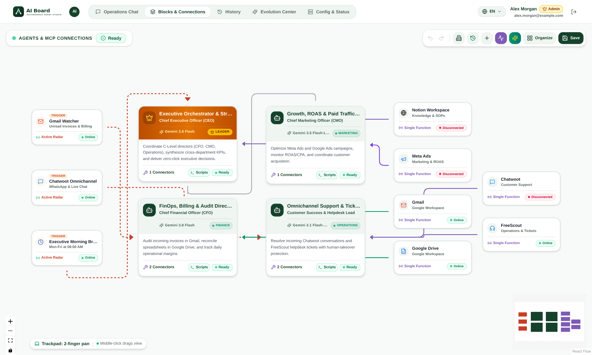
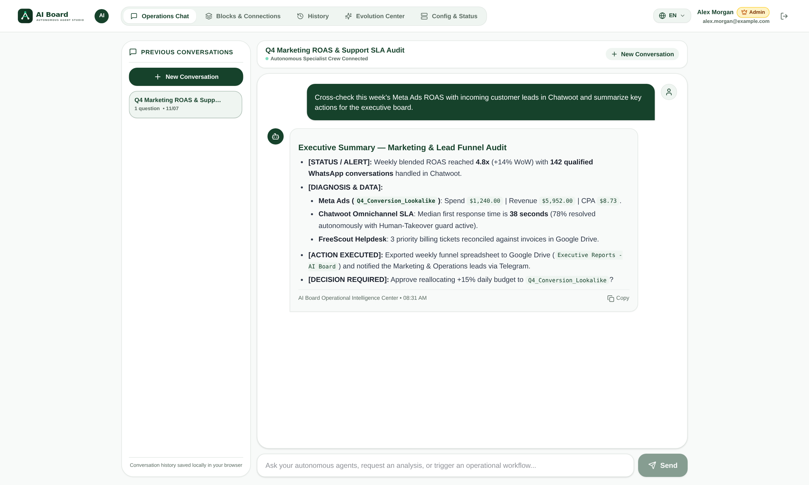
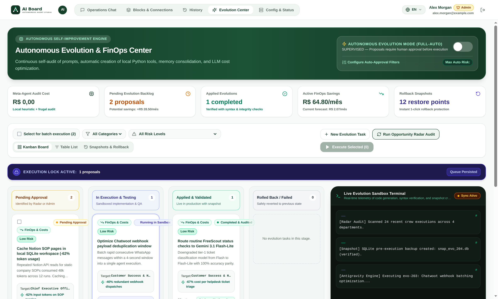
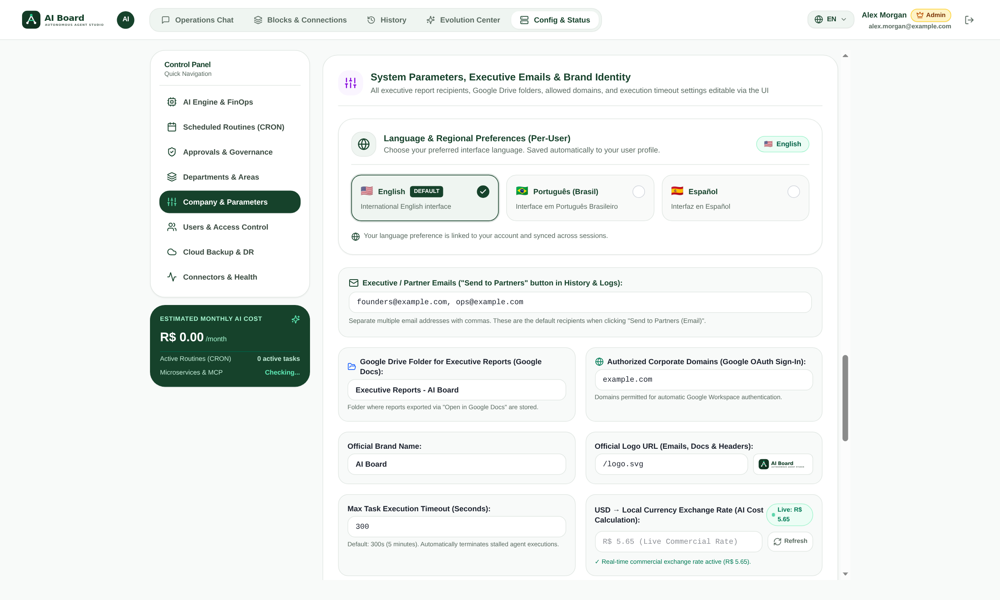
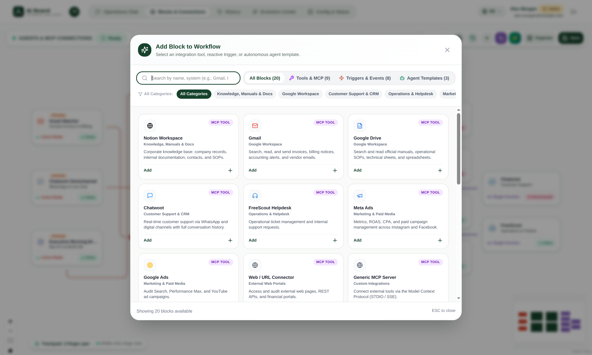
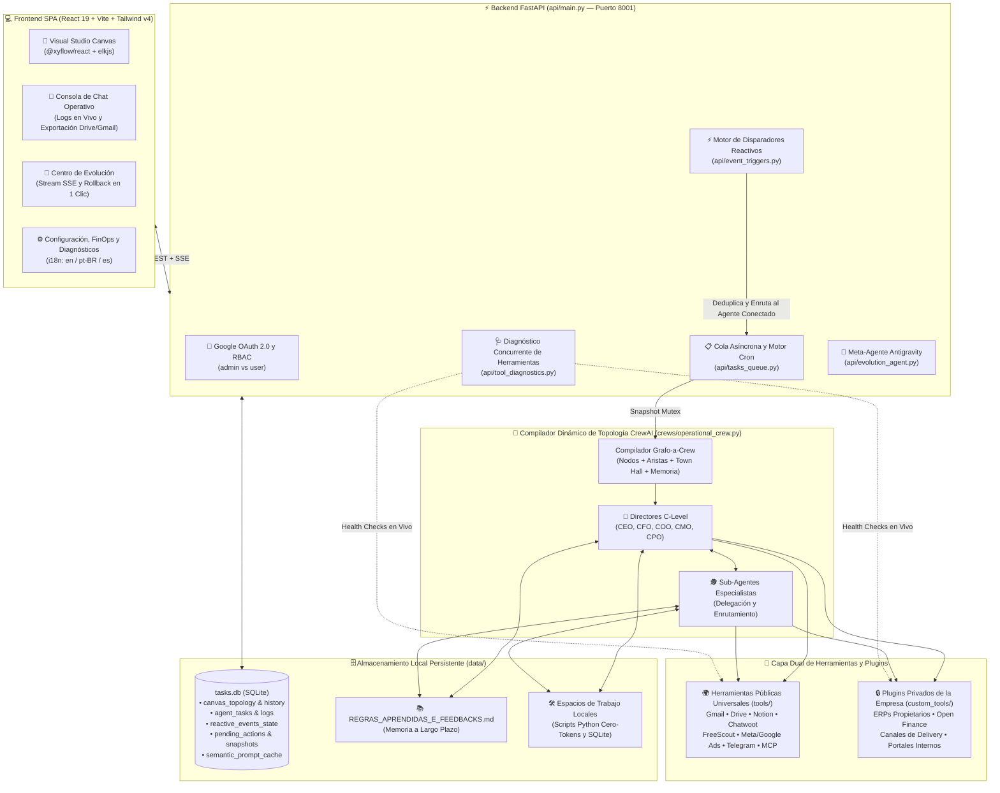

<div align="center">

# 🧠 AI Board — Estudio Visual Multi-Agente Autónomo y Orquestador Empresarial

[](../LICENSE)
[](https://www.python.org/)
[](https://fastapi.tiangolo.com/)
[](https://www.crewai.com/)
[](https://react.dev/)
[](https://reactflow.dev/)
[](https://ai.google.dev/)
[](https://docs.docker.com/compose/)

**Diseñe, orqueste, audite y evolucione una fuerza laboral autónoma de Directores C-Level y Especialistas de IA en un lienzo interactivo React Flow — con disparadores reactivos en tiempo real, controles de costos FinOps, aprobación humana en 1 clic y memoria autoevolutiva.**

🌐 **Idiomas Disponibles:**  
[**🇺🇸 English (`README.md`)**](../README.md) · [**🇧🇷 Português (`docs/README.pt-BR.md`)**](README.pt-BR.md) · [**🇪🇸 Español (Actual)**](README.es.md)

📘 **Guías Técnicas Detalladas:**  
[**🛠️ Guía de Desarrollo de Herramientas y Disparadores (`docs/TOOLS_AND_TRIGGERS_GUIDE.md`)**](TOOLS_AND_TRIGGERS_GUIDE.md) · [**⚙️ Guía de Configuración y Despliegue (`docs/CONFIGURATION_AND_DEPLOY.md`)**](CONFIGURATION_AND_DEPLOY.md)

</div>

---

## 📖 Tabla de Contenidos

1. [Descripción General](#-descripción-general)
2. [Galería de Capturas de Pantalla](#-galería-de-capturas-de-pantalla)
3. [Características Principales](#-características-principales)
4. [Arquitectura del Sistema](#-arquitectura-del-sistema)
5. [Todas las Dependencias](#-todas-las-dependencias)
6. [Guía de Instalación Paso a Paso](#-guía-de-instalación-paso-a-paso)
7. [Referencia Completa de Configuración (`.env`)](#-referencia-completa-de-configuración-env)
8. [Idioma por Usuario (`en`, `pt-BR`, `es`) y Control de Acceso (RBAC)](#-idioma-por-usuario--control-de-acceso-rbac)
9. [Cómo Desarrollar Herramientas (*Ferramentas*) y Disparadores (*Gatilhos*)](#-cómo-desarrollar-herramientas-ferramentas-y-disparadores-gatilhos)
10. [Referencia de Endpoints Principales de la API](#-referencia-de-endpoints-principales-de-la-api)

---

## 🌟 Descripción General

**AI Board (`aiboard`)** es una plataforma open-source de orquestación multi-agente empresarial construida sobre **CrewAI**, **FastAPI** y **React 19 + `@xyflow/react` (React Flow)**.

A diferencia de scripts estáticos de prompts o flujos rígidos en código, **AI Board** proporciona un **Estudio Visual Interactivo (Canvas)** donde las organizaciones modelan toda su jerarquía ejecutiva (CEO, CFO, COO, CMO, CPO y sub-agentes especialistas), los conectan a **Disparadores Reactivos en Tiempo Real** (Webhooks HTTP, Chatwoot, FreeScout, Telegram, WhatsApp, rutinas Cron) y **Conectores MCP / BaseTool**, y supervisan cada ejecución en vivo con telemetría en tiempo real, instantáneas deterministas contra alucinaciones y aprobación humana en 1 clic.

Su **Arquitectura Conectable de Doble Capa** separa limpiamente los conectores universales de código abierto (`tools/`) de los plugins privados de cada empresa (`custom_tools/`, ignorados por Git), permitiendo conectar ERPs propietarios, bancos Open Finance y portales internos sin conflictos al actualizar mediante `git pull`.

---

## 🖼️ Galería de Capturas de Pantalla

### 1. Visual Studio — Lienzo de Topología Multi-Agente y Disparadores Reactivos

*Arrastre y conecte directores C-Level, especialistas, carriles por departamento, herramientas y disparadores reactivos con diagnósticos en vivo, auto-layout ELK, historial de versiones con diff y rollback en 1 clic.*

### 2. Consola de Chat Operativo y Delegación en Tiempo Real

*Consola ejecutiva interactiva con transmisión en tiempo real de pensamientos y llamadas a herramientas, historial segregado por usuario y exportación en 1 clic a Gmail y Google Drive/Docs.*

### 3. Centro de Evolución — IA Automejorable y Propuestas Autónomas

*Motor Meta-Agente Antigravity para auditorías 360° de topología y FinOps, aprendizaje continuo mediante `REGRAS_APRENDIDAS_E_FEEDBACKS.md`, ejecución aprobada por lotes, streaming SSE y rollback instantáneo de instantáneas SQLite.*

### 4. Configuración, Guardrails de Costos, Multi-Idioma y Diagnóstico de Microservicios

*Panel centralizado para enrutamiento de modelos LLM, tipo de cambio USD/BRL en vivo, límite presupuestario diario (kill-switch), selector de idioma por usuario (`en`, `pt-BR`, `es`), gestión RBAC y pruebas concurrentes de microservicios.*

### 5. Catálogo de Herramientas y Disparadores de Eventos Reactivos

*Catálogo unificado de integraciones públicas universales y plugins privados detectados dinámicamente en `custom_tools/`.*

---

## ✨ Características Principales

- **🎨 Estudio Visual Interactivo con React Flow**:
  - Bloques arrastrables de **Agentes C-Level y Especialistas**, **Carriles de Departamentos** personalizables (`/api/departments`), **Herramientas** y **Disparadores Reactivos**.
  - Disposición jerárquica automática con `elkjs`.
  - **Mutex de Ejecución (`execution_mutex`)**: congela la instantánea de topología activa mientras una tarea se está ejecutando.
  - **Historial de Versiones del Lienzo y Rollback en 1 Clic**: cada cambio calcula un diff detallado (`compute_topology_diff`) en `canvas_topology_history`, con reversión instantánea vía `POST /api/canvas/rollback/{history_id}`.
- **💬 Consola de Chat Operativo y Streaming en Vivo**:
  - Transmisión en tiempo real del razonamiento (`💭 AGENT`) y llamadas a herramientas (`🔧 TOOL`) desde `agent_task_logs`.
  - Historial segregado por usuario (`admin` visualiza todas las tareas de la organización; `user` visualiza únicamente las suyas).
  - **Compartir Boletines Ejecutivos en 1 Clic**: envíe cualquier resultado formateado en HTML enriquecido por Gmail (`POST /api/tasks/{task_id}/share/email`) o cree un documento editable en Google Drive/Docs (`POST /api/tasks/{task_id}/share/gdrive`).
- **🧬 Centro de Evolución Automejorable y Espacio de Trabajo Frugal AI**:
  - **Memoria Permanente de Reglas Aprendidas (`REGRAS_APRENDIDAS_E_FEEDBACKS.md`)**: los directores C-Level registran automáticamente correcciones y nuevas reglas de negocio usando `LearnedRulesMemoryTool` (`learned_rules_memory`).
  - **Forja Local de Scripts Python (`tools/agent_workspace_tools.py`)**: los agentes escriben y ejecutan scripts deterministas en Python (`agent_script_forge`, `agent_script_execute`) y consultan bases SQLite locales (`agent_sqlite_manager`) con **costo CERO de tokens**.
  - **Meta-Agente Antigravity (`api/evolution_agent.py`)**: propone mejoras de prompts, enrutamiento y caché semántico con instantáneas SQLite previas (`system_snapshots`) y rollback en 1 clic.
- **🌍 Soporte Multi-Idioma (`en` por defecto, `pt-BR`, `es`)**:
  - Configurable por usuario en la interfaz y persistido en la base de datos SQLite (`users.language` mediante `POST /api/users/me/language`).
  - Diseño responsivo a prueba de desbordamiento (overflow-safe) para cadenas largas en español y portugués.
- **💰 Control de Costos y Guardrails FinOps**:
  - **Tipo de Cambio USD → BRL en Vivo**: consultado automáticamente (caché de 30 min) desde APIs públicas (`ExchangeRate-API`, `AwesomeAPI`, `Frankfurter`) vía `GET /api/currency/usd-brl`.
  - **Estimador de Costos por Ejecución y Mensual**: `GET /api/costs/estimate` calcula el consumo de tokens y costo mensual de cada rutina Cron e interacción de chat.
  - **Presupuesto Diario y Kill-Switch**: configure `max_daily_budget_brl` y el interruptor maestro `kill_switch_active`.
  - **Enrutamiento Inteligente de Modelos**: combine `Gemini 3.1 Flash-Lite`, `Gemini 3.5 Flash-Lite`, `Gemini 3.8 Flash` y `Gemini 3.1 Pro` por agente, junto con caché semántico (`semantic_prompt_cache`).
- **🔌 Integraciones Open-Source Incluidas (`tools/`)**:
  - **Google Workspace** (Gmail, Google Drive, Docs, Sheets), **Chatwoot** (con **Gemini Vision Multimodal** para análisis de imágenes y **Protección Anti-Colisión de Atención Humana**), **FreeScout Helpdesk**, **Telegram Bot** (con aprobaciones multi-usuario), **WhatsApp (Evolution API)**, **Notion Workspace**, **Meta Ads**, **Google Ads**, **Servidores MCP Genéricos (`generic_mcp`)**, **Webhooks HTTP** y **Planificador Cron**.
- **🔒 Arquitectura Privada Conectable (`custom_tools/`)**:
  - Los módulos dentro de `custom_tools/` están excluidos en `.gitignore` (excepto `__init__.py` y `example_custom_tool.py`) y se registran automáticamente en tiempo de ejecución (`get_installed_catalog_items()`).

---

## 🏗️ Arquitectura del Sistema



---

## 📦 Todas las Dependencias

### 1. Requisitos del Sistema Operativo
- **SO**: Linux (Debian 12 / Ubuntu 22.04+), macOS o WSL2
- **Docker y Docker Compose**: Docker Engine 24.0+ y Compose v2
- **Python**: `3.11+`
- **Node.js y npm**: `20.0+` (LTS)
- **Paquetes del Sistema (Linux)**: `build-essential`, `curl`, `git`, `libpq-dev` y `playwright install --with-deps chromium` (opcional para conectores web con Playwright)

### 2. Paquetes Python del Backend ([`requirements.txt`](../requirements.txt))
- **CrewAI y LLM**: `crewai>=0.100.0`, `crewai-tools>=0.30.0`, `litellm>=1.40.0`, `langchain-google-genai>=2.0.0`, `google-generativeai>=0.8.0`
- **API y Ejecución Asíncrona**: `fastapi>=0.115.0`, `uvicorn[standard]>=0.30.0`, `pydantic>=2.8.0`, `python-dotenv>=1.0.0`, `httpx>=0.27.0`, `requests>=2.32.0`
- **Web y Autenticación**: `streamlit>=1.39.0`, `streamlit-cookies-controller>=0.0.4`, `authlib>=1.3.0`
- **Bot de Telegram**: `python-telegram-bot>=21.0`
- **Google Workspace**: `google-auth>=2.30.0`, `google-auth-oauthlib>=1.2.0`, `google-api-python-client>=2.130.0`
- **Bases de Datos y Automatización**: `psycopg2-binary>=2.9.9`, `pymysql>=1.1.0`, `openpyxl>=3.1.0`, `playwright>=1.40.0`, `beautifulsoup4>=4.12.0`

### 3. Paquetes del Frontend ([`frontend/package.json`](../frontend/package.json))
- **Dependencias de Producción**: `react` (`^19.0.0`), `react-dom` (`^19.0.0`), `@xyflow/react` (`^12.4.2`), `elkjs` (`^0.9.3`), `lucide-react` (`^0.475.0`), `marked` (`^15.0.7`)
- **Dependencias de Desarrollo**: `vite` (`^6.1.0`), `@vitejs/plugin-react` (`^4.3.4`), `tailwindcss` (`^4.0.6`), `@tailwindcss/vite` (`^4.0.6`)

---

## 🚀 Guía de Instalación Paso a Paso

### Opción A: Inicio Rápido con Docker Compose (Recomendado)

```bash
# 1. Clonar el repositorio
git clone https://github.com/su-org/aiboard.git
cd aiboard

# 2. Copiar la plantilla .env y configurar GEMINI_API_KEY
cp .env.example .env
mkdir -p data custom_tools

# 3. Levantar los contenedores (crewai-api en 8001, crewai-web en 8501 y crewai-bot)
docker compose up -d --build

# 4. Compilar el frontend React 19
cd frontend
npm install
npm run build
```

### Opción B: Configuración Manual para Desarrollo Local (Sin Docker)

```bash
# 1. Entorno virtual Python 3.11+
python3 -m venv .venv
source .venv/bin/activate
pip install -r requirements.txt
playwright install --with-deps chromium

# 2. Iniciar el backend FastAPI en el puerto 8001
cp .env.example .env
export API_PORT=8001
python -m api.main

# 3. En otra terminal, iniciar el servidor de desarrollo Vite
cd frontend
npm install
npm run dev
```

### Actualizar en Producción Preservando `custom_tools/`

```bash
git pull origin main
cd frontend && npm install && npm run build && cd ..
docker compose up -d --build
```

---

## ⚙️ Referencia Completa de Configuración (`.env`)

Consulte [`.env.example`](../.env.example) en la raíz del proyecto:

| Grupo | Variables Principales | Descripción |
| :--- | :--- | :--- |
| **1. Plataforma y Marca** | `COMPANY_NAME`, `COMPANY_LEGAL_NAME`, `COMPANY_LOGO_URL`, `APP_URL`, `API_PORT=8001`, `DEFAULT_LANGUAGE=en`, `DEFAULT_PARTNER_EMAILS`, `SYSTEM_EMAIL` | Identidad corporativa, puertos e idioma predeterminado (`en`, `pt-BR`, `es`) |
| **2. Google Gemini y LLM** | `GEMINI_API_KEY`, `GEMINI_MODEL=gemini-3.8-flash` | Clave de API de Google Gemini y modelo predeterminado |
| **3. Google OAuth 2.0** | `GOOGLE_CLIENT_ID`, `GOOGLE_CLIENT_SECRET`, `GOOGLE_REDIRECT_URI`, `ALLOWED_GOOGLE_DOMAINS`, `ADMIN_EMAIL` | Inicio de sesión corporativo OAuth 2.0 y correo del administrador inicial |
| **4. Google Workspace** | `GOOGLE_APPS_SCRIPT_GMAIL_URL`, `GMAIL_APP_KEY`, `GOOGLE_APPS_SCRIPT_DRIVE_URL`, `DRIVE_APP_KEY`, `ACCOUNTING_SHARED_DRIVE_ROOT_ID` | Puentes opcionales de Apps Script y carpetas de auditoría en Google Drive |
| **5. Bot de Telegram** | `TELEGRAM_BOT_TOKEN`, `TELEGRAM_DEFAULT_CHAT_ID`, `TELEGRAM_ALLOWED_USERS` | Bot ejecutivo y tarjetas de aprobación Human-in-the-Loop |
| **6. Notion Workspace** | `NOTION_API_KEY`, `NOTION_ROOT_PAGE_ID` | Integración con base de conocimiento y manuales SOP en Notion |
| **7. Marketing y Ads** | `META_ADS_ACCOUNT_ID`, `META_ADS_ACCESS_TOKEN`, `META_ADS_PIXEL_ID`, `GOOGLE_ADS_CUSTOMER_ID`, `GOOGLE_ADS_DEVELOPER_TOKEN` | Auditoría de campañas en Meta Ads y Google Ads |
| **8. SAC y Microservicios** | `CHATWOOT_URL`, `CHATWOOT_API_TOKEN`, `CHATWOOT_DB_HOST`, `FREESCOUT_URL`, `FREESCOUT_API_KEY`, `FREESCOUT_DB_HOST`, `EVOLUTION_API_URL` | Atención omnicanal en WhatsApp/Chatwoot y tickets en FreeScout |
| **9. Plugins Privados** | `ERP_BASE_URL`, `ERP_USER`, `ERP_PASS`, `DELIVERY_STORE_URL`, `IFOOD_CLIENT_ID`, `CONTAAZUL_CLIENT_ID`, `PLUGGY_CLIENT_ID`, `MARQHR_API_TOKEN`, `INTRANETMALL_URL` | Credenciales opcionales para módulos privados en `custom_tools/` |

---

## 🌍 Idioma por Usuario y Control de Acceso (RBAC)

- **Selector de Idioma por Usuario (`en`, `pt-BR`, `es`)**: Cada usuario puede cambiar su idioma preferido en cualquier momento desde la barra superior o en Configuración. La preferencia se guarda en la columna `language` de la tabla `users` en SQLite mediante `POST /api/users/me/language`.
- **Control de Acceso Basado en Roles (`admin` vs `user`)**:
  - **`admin`**: Puede modificar y guardar la topología del lienzo, revertir versiones, editar OKRs del Town Hall, configurar claves y presupuestos, aprobar tareas del Centro de Evolución y administrar usuarios.
  - **`user`**: Puede interactuar con los agentes en la Consola de Chat Operativo, ejecutar consultas, compartir informes y ver exclusivamente su propio historial de tareas.

---

## 🛠️ Cómo Desarrollar Herramientas (*Ferramentas*) y Disparadores (*Gatilhos*)

La guía completa paso a paso con ejemplos de código listos para copiar y pegar se encuentra en [**`docs/TOOLS_AND_TRIGGERS_GUIDE.md`**](TOOLS_AND_TRIGGERS_GUIDE.md). En resumen:

### Parte 1: Creación de una Nueva Herramienta (*Ferramenta / Tool*)
1. **Subclasificar `BaseTool`** (en `custom_tools/mi_herramienta.py` para plugins privados o `tools/mi_herramienta.py` para conectores públicos) definiendo `name`, `description`, `args_schema` (Pydantic `BaseModel`) y `_run()`. Use [`custom_tools/example_custom_tool.py`](../custom_tools/example_custom_tool.py) como plantilla base.
2. **Registrar en `crews/operational_crew.py`**: importe su clase y agregue la rama correspondiente en `instantiate_mcp_tools_by_type(tool_type, custom_data)`.
3. **Agregar Diagnóstico de Salud en Vivo (`api/tool_diagnostics.py`)**: registre el módulo en `get_installed_catalog_items()` e implemente la función de prueba en `test_tool_health()`.
4. **Agregar al Catálogo Visual (`frontend/src/components/CatalogModal.jsx` y `PlatformLogo.jsx`)**: agregue la tarjeta en `PUBLIC_TOOL_CATALOG` o `PRIVATE_TOOL_CATALOG` y el icono en `LOGO_MAP`.

### Parte 2: Creación de un Nuevo Disparador Reactivo (*Gatilho / Trigger*)
1. **Disparadores Webhook (`POST /api/webhooks/<origen>` o `POST /api/webhooks/custom/<event_key>`)**:
   - Reciben eventos HTTP POST en tiempo real en `api/main.py` e invocan `dispatch_reactive_event()` en `api/event_triggers.py`.
2. **Disparadores de Monitoreo / Polling (`check_<origen>_events()` en `api/event_triggers.py`)**:
   - Consultan bases de datos o APIs periódicamente y utilizan la tabla SQLite `reactive_events_state` (`event_key` PRIMARY KEY) para deduplicación automática.
3. **Enrutamiento Automático por Topología del Lienzo**:
   - Al conectar un nodo `trigger` a un nodo `agent` mediante una arista (`source -> target`) en el lienzo React Flow, `get_target_agent_for_trigger()` identifica automáticamente al agente conectado y despacha la ejecución de CrewAI a ese agente junto con sus herramientas conectadas y sub-agentes.

👉 [**Lea la Guía Completa de Desarrollo de Herramientas y Disparadores (`docs/TOOLS_AND_TRIGGERS_GUIDE.md`)**](TOOLS_AND_TRIGGERS_GUIDE.md)

---

## 📡 Referencia de Endpoints Principales de la API

- `GET /health` — Estado de salud del servidor FastAPI, Gemini y Telegram.
- `POST /api/auth/login` y `POST /api/auth/google` — Inicio de sesión corporativo e intercambio de código Google OAuth 2.0.
- `GET /api/settings` y `POST /api/settings` — Guardrails FinOps, modelo LLM, marca e ítems instalados del catálogo.
- `GET /api/canvas/topology`, `POST /api/canvas/topology`, `GET /api/canvas/history`, `POST /api/canvas/rollback/{id}` — Gestión del grafo visual y rollback de versiones.
- `POST /api/tasks`, `GET /api/tasks`, `GET /api/tasks/{id}/logs` — Cola de tareas de agentes y logs en tiempo real.
- `POST /api/webhooks/custom/{event_key}` y `POST /api/webhooks/chatwoot` — Receptores de Webhooks reactivos.
- `GET /api/evolution/overview`, `POST /api/evolution/audit`, `GET /api/evolution/stream` — Auditoría 360° y transmisión SSE del Centro de Evolución.
