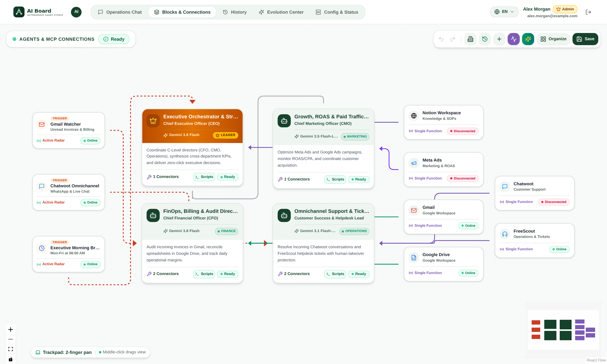
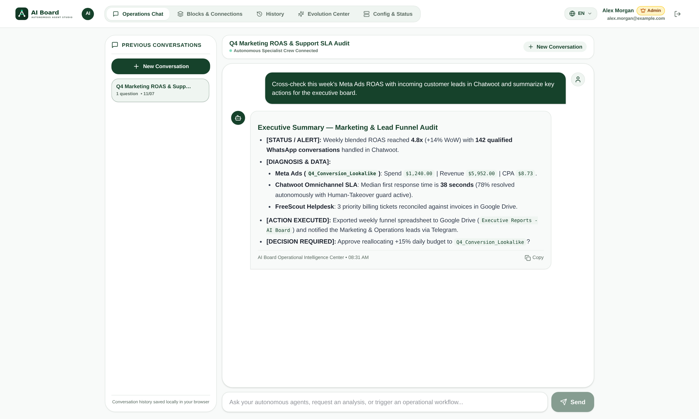
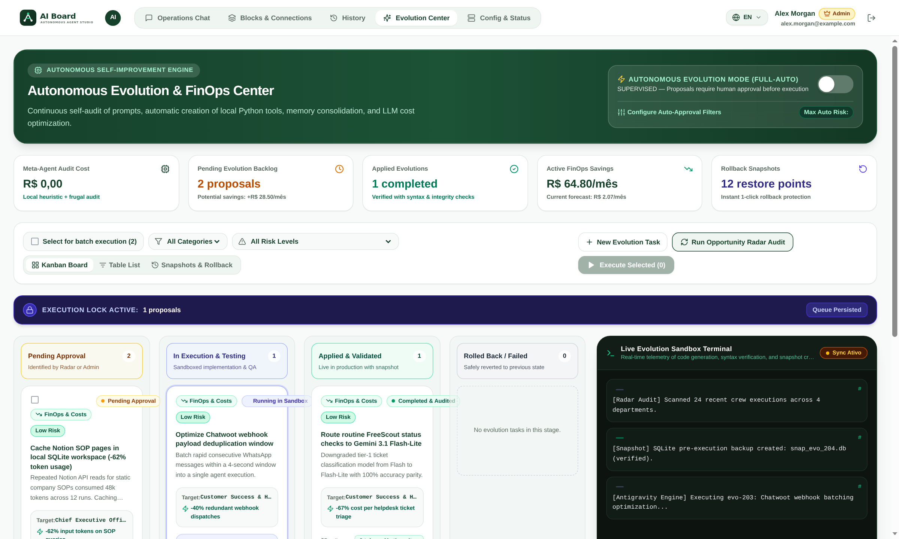
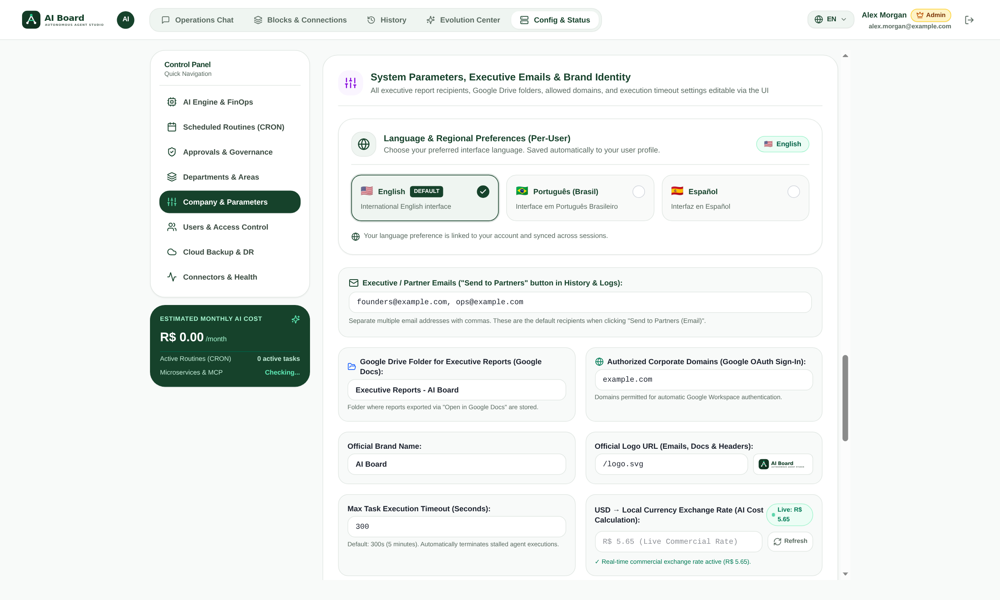
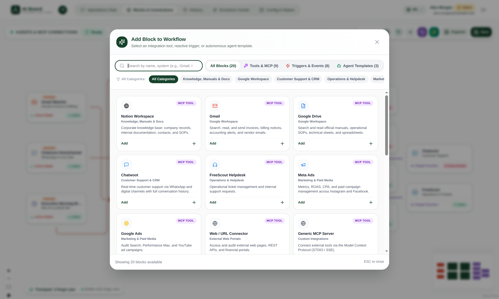
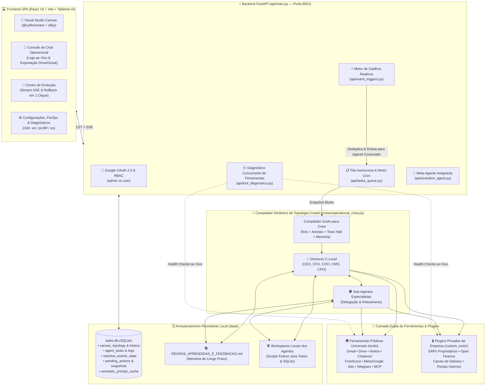

<div align="center">

# 🧠 AI Board — Estúdio Visual Multi-Agente Autônomo & Orquestrador Corporativo

[](../LICENSE)
[](https://www.python.org/)
[](https://fastapi.tiangolo.com/)
[](https://www.crewai.com/)
[](https://react.dev/)
[](https://reactflow.dev/)
[](https://ai.google.dev/)
[](https://docs.docker.com/compose/)

**Projete, orquestre, audite e evolua uma força de trabalho autônoma de Diretores C-Level e Especialistas de IA em um canvas interativo React Flow — com gatilhos reativos em tempo real, guardrails FinOps de custo, aprovação humana em 1 clique e memória auto-evolutiva.**

🌐 **Idiomas Disponíveis:**  
[**🇺🇸 English (`README.md`)**](../README.md) · [**🇧🇷 Português (Atual)**](README.pt-BR.md) · [**🇪🇸 Español (`docs/README.es.md`)**](README.es.md)

📘 **Guias Técnicos Aprofundados:**  
[**🛠️ Guia de Desenvolvimento de Ferramentas & Gatilhos (`docs/TOOLS_AND_TRIGGERS_GUIDE.md`)**](TOOLS_AND_TRIGGERS_GUIDE.md) · [**⚙️ Guia de Configuração & Deploy (`docs/CONFIGURATION_AND_DEPLOY.md`)**](CONFIGURATION_AND_DEPLOY.md)

</div>

---

## 📖 Índice

1. [Visão Geral](#-visão-geral)
2. [Galeria de Capturas de Tela](#-galeria-de-capturas-de-tela)
3. [Principais Recursos](#-principais-recursos)
4. [Arquitetura do Sistema](#-arquitetura-do-sistema)
5. [Todas as Dependências](#-todas-as-dependências)
6. [Guia de Instalação Passo a Passo](#-guia-de-instalação-passo-a-passo)
7. [Referência Completa de Configuração (`.env`)](#-referência-completa-de-configuração-env)
8. [Idioma por Usuário (`en`, `pt-BR`, `es`) & Controle de Acesso (RBAC)](#-idioma-por-usuário--controle-de-acesso-rbac)
9. [Como Desenvolver Novas Ferramentas (Tools) e Gatilhos (Triggers)](#-como-desenvolver-novas-ferramentas-tools-e-gatilhos-triggers)
10. [Referência dos Principais Endpoints da API](#-referência-dos-principais-endpoints-da-api)

---

## 🌟 Visão Geral

O **AI Board (`aiboard`)** é uma plataforma open-source de orquestração multi-agente empresarial construída sobre **CrewAI**, **FastAPI** e **React 19 + `@xyflow/react` (React Flow)**.

Diferente de scripts estáticos de prompt ou pipelines rígidos em código, o **AI Board** oferece um **Estúdio Visual Interativo (Canvas)** onde sua organização modela todo o organograma executivo (CEO, CFO, COO, CMO, CPO e agentes especialistas), conecta-os a **Gatilhos Reativos em Tempo Real** (Webhooks HTTP, Chatwoot, FreeScout, Telegram, WhatsApp, rotinas Cron) e **Ferramentas MCP / BaseTool**, acompanhando cada execução ao vivo com telemetria detalhada, travas anti-alucinação e aprovação humana em 1 clique.

Sua **Arquitetura Plugável em Duas Camadas** separa conectores universais open-source (`tools/`) de plugins privados da empresa (`custom_tools/`, ignorados pelo Git), permitindo integrar ERPs proprietários, bancos Open Finance e portais internos sem conflitos ao atualizar o repositório via `git pull`.

---

## 🖼️ Galeria de Capturas de Tela

### 1. Visual Studio — Canvas de Topologia Multi-Agente & Gatilhos Reativos

*Arraste e conecte diretores C-Level, especialistas, raias de departamentos, ferramentas e gatilhos reativos com diagnósticos de saúde ao vivo, auto-layout ELK, histórico de versões com diff e rollback em 1 clique.*

### 2. Console de Chat Operacional & Delegação em Tempo Real

*Console executivo com transmissão em tempo real do raciocínio dos agentes e chamadas de ferramentas, histórico segregado por usuário e compartilhamento em 1 clique por Gmail e Google Drive/Docs.*

### 3. Centro de Evolução — IA Auto-Aperfeiçoável & Propostas Autônomas

*Motor Meta-Agente Antigravity para auditoria 360º de topologia e FinOps, aprendizado contínuo via `REGRAS_APRENDIDAS_E_FEEDBACKS.md`, aprovação em lote, streaming SSE e rollback instantâneo de snapshots SQLite.*

### 4. Configurações, Guardrails de Custo, Multi-Idioma & Diagnóstico de Microserviços

*Painel de governança para roteamento de modelos LLM, cotação USD/BRL ao vivo, teto diário de gastos (kill-switch), seletor de idioma por usuário (`en`, `pt-BR`, `es`), gestão de permissões e testes concorrentes de microserviços.*

### 5. Catálogo de Ferramentas & Gatilhos de Eventos Reativos

*Catálogo unificado de integrações públicas universais e plugins privados descobertos dinamicamente em `custom_tools/`.*

---

## ✨ Principais Recursos

- **🎨 Estúdio Visual Interativo em React Flow**:
  - Blocos arrastáveis de **Agentes C-Level e Especialistas**, **Raias de Departamentos** customizáveis (`/api/departments`), **Ferramentas** e **Gatilhos Reativos**.
  - Organização hierárquica automática via `elkjs`.
  - **Mutex de Execução (`execution_mutex`)**: congela o snapshot da topologia ativa durante a execução de tarefas.
  - **Histórico de Versões do Canvas & Rollback em 1 Clique**: cada alteração calcula o diff estrutural (`compute_topology_diff`) salvo em `canvas_topology_history`, permitindo restauração imediata via `POST /api/canvas/rollback/{history_id}`.
- **💬 Console de Chat Operacional & Streaming de Execução ao Vivo**:
  - Logs em tempo real do raciocínio (`💭 AGENT`) e invocação de ferramentas (`🔧 TOOL`) via `agent_task_logs`.
  - Histórico segregado por nível de acesso (`admin` visualiza todas as tarefas; `user` visualiza apenas as próprias).
  - **Compartilhamento de Boletins Executivos em 1 Clique**: envie o relatório formatado em HTML rico por Gmail (`POST /api/tasks/{task_id}/share/email`) ou gere um documento editável no Google Drive/Docs (`POST /api/tasks/{task_id}/share/gdrive`).
- **🧬 Centro de Evolução Auto-Aperfeiçoável & Workspace Frugal AI**:
  - **Memória Permanente de Regras Aprendidas (`REGRAS_APRENDIDAS_E_FEEDBACKS.md`)**: diretores C-Level gravam automaticamente novos feedbacks e regras de negócio via `LearnedRulesMemoryTool` (`learned_rules_memory`).
  - **Forja Autônoma de Scripts Python Locais (`tools/agent_workspace_tools.py`)**: agentes criam e executam scripts Python determinísticos (`agent_script_forge`, `agent_script_execute`) e bancos SQLite locais (`agent_sqlite_manager`) com **custo ZERO de tokens**.
  - **Meta-Agente Antigravity (`api/evolution_agent.py`)**: propõe otimizações de prompts, roteamento e cache semântico com snapshot prévio no SQLite (`system_snapshots`) e rollback em 1 clique.
- **🌍 Suporte Multi-Idioma (`en` padrão, `pt-BR`, `es`)**:
  - Configurável individualmente por usuário no topo da interface ou nas configurações e persistido no banco SQLite (`users.language` via `POST /api/users/me/language`).
  - Layout responsivo projetado contra quebra de texto (overflow-safe) para textos em Português, Espanhol e Inglês.
- **💰 Controle de Custos & Guardrails FinOps**:
  - **Cotação Comercial USD → BRL ao Vivo**: consultada automaticamente (cache de 30 min) em APIs públicas (`ExchangeRate-API`, `AwesomeAPI`, `Frankfurter`) via `GET /api/currency/usd-brl`.
  - **Estimador Dinâmico de Custo Mensal e por Rotina**: `GET /api/costs/estimate` calcula o custo em R$ e US$ de cada rotina CRON e interação de chat.
  - **Teto Diário de Gastos & Kill-Switch**: defina `max_daily_budget_brl` e a trava mestre de emergência `kill_switch_active`.
  - **Roteamento Inteligente de Modelos**: combine `Gemini 3.1 Flash-Lite`, `Gemini 3.5 Flash-Lite`, `Gemini 3.8 Flash` e `Gemini 3.1 Pro` por agente, além de cache semântico (`semantic_prompt_cache`).
- **🔌 Integrações Open-Source Nativas (`tools/`)**:
  - **Google Workspace** (Gmail, Google Drive, Docs, Sheets), **Chatwoot** (com **Gemini Vision Multimodal** para fotos de equipamentos/balanças e **Proteção Anti-Colisão de Atendimento Humano**), **FreeScout Helpdesk**, **Telegram Bot** (com cartões de aprovação multi-usuário), **WhatsApp (Evolution API)**, **Notion Workspace**, **Meta Ads**, **Google Ads**, **Servidores MCP Genéricos (`generic_mcp`)**, **Webhooks HTTP** e **Agendador Cron**.
- **🔒 Arquitetura Privada Plugável (`custom_tools/`)**:
  - Módulos em `custom_tools/` são ignorados pelo Git (exceto `__init__.py` e `example_custom_tool.py`) e detectados automaticamente em tempo de execução (`get_installed_catalog_items()`).

---

## 🏗️ Arquitetura do Sistema



---

## 📦 Todas as Dependências

### 1. Requisitos de Sistema Operacional
- **SO**: Linux (Debian 12 / Ubuntu 22.04+), macOS ou WSL2
- **Docker & Docker Compose**: Docker Engine 24.0+ e Compose v2
- **Python**: `3.11+`
- **Node.js & npm**: `20.0+` (LTS)
- **Pacotes de Sistema (Linux)**: `build-essential`, `curl`, `git`, `libpq-dev` e `playwright install --with-deps chromium` (opcional para conectores web Playwright)

### 2. Pacotes Python do Backend ([`requirements.txt`](../requirements.txt))
- **CrewAI & LLM**: `crewai>=0.100.0`, `crewai-tools>=0.30.0`, `litellm>=1.40.0`, `langchain-google-genai>=2.0.0`, `google-generativeai>=0.8.0`
- **API & Execução**: `fastapi>=0.115.0`, `uvicorn[standard]>=0.30.0`, `pydantic>=2.8.0`, `python-dotenv>=1.0.0`, `httpx>=0.27.0`, `requests>=2.32.0`
- **Web & Autenticação**: `streamlit>=1.39.0`, `streamlit-cookies-controller>=0.0.4`, `authlib>=1.3.0`
- **Telegram Bot**: `python-telegram-bot>=21.0`
- **Google Workspace**: `google-auth>=2.30.0`, `google-auth-oauthlib>=1.2.0`, `google-api-python-client>=2.130.0`
- **Bancos de Dados & Automação**: `psycopg2-binary>=2.9.9`, `pymysql>=1.1.0`, `openpyxl>=3.1.0`, `playwright>=1.40.0`, `beautifulsoup4>=4.12.0`

### 3. Pacotes do Frontend ([`frontend/package.json`](../frontend/package.json))
- **Dependências de Produção**: `react` (`^19.0.0`), `react-dom` (`^19.0.0`), `@xyflow/react` (`^12.4.2`), `elkjs` (`^0.9.3`), `lucide-react` (`^0.475.0`), `marked` (`^15.0.7`)
- **Dependências de Build**: `vite` (`^6.1.0`), `@vitejs/plugin-react` (`^4.3.4`), `tailwindcss` (`^4.0.6`), `@tailwindcss/vite` (`^4.0.6`)

---

## 🚀 Guia de Instalação Passo a Passo

### Opção A: Início Rápido com Docker Compose (Recomendado)

```bash
# 1. Clone o repositório
git clone https://github.com/sua-org/aiboard.git
cd aiboard

# 2. Copie o arquivo de variáveis de ambiente e configure sua GEMINI_API_KEY
cp .env.example .env
mkdir -p data custom_tools

# 3. Suba os containers (crewai-api na porta 8001, crewai-web na 8501 e crewai-bot)
docker compose up -d --build

# 4. Compile o frontend React 19
cd frontend
npm install
npm run build
```

### Opção B: Instalação Local para Desenvolvimento (Sem Docker)

```bash
# 1. Ambiente virtual Python 3.11+
python3 -m venv .venv
source .venv/bin/activate
pip install -r requirements.txt
playwright install --with-deps chromium

# 2. Inicie o backend FastAPI na porta 8001
cp .env.example .env
export API_PORT=8001
python -m api.main

# 3. Em outro terminal, inicie o servidor Vite do Frontend
cd frontend
npm install
npm run dev
```

### Atualizando em Produção Preservando `custom_tools/`

```bash
git pull origin main
cd frontend && npm install && npm run build && cd ..
docker compose up -d --build
```

---

## ⚙️ Referência Completa de Configuração (`.env`)

Consulte o arquivo [`.env.example`](../.env.example) na raiz do projeto:

| Grupo | Variáveis Principais | Descrição |
| :--- | :--- | :--- |
| **1. Plataforma & Marca** | `COMPANY_NAME`, `COMPANY_LEGAL_NAME`, `COMPANY_LOGO_URL`, `APP_URL`, `API_PORT=8001`, `DEFAULT_LANGUAGE=en`, `DEFAULT_PARTNER_EMAILS`, `SYSTEM_EMAIL` | Identidade visual da organização, portas e idioma padrão (`en`, `pt-BR`, `es`) |
| **2. Google Gemini & LLM** | `GEMINI_API_KEY`, `GEMINI_MODEL=gemini-3.8-flash` | Chave da API Google Gemini e modelo padrão da plataforma |
| **3. Google OAuth 2.0** | `GOOGLE_CLIENT_ID`, `GOOGLE_CLIENT_SECRET`, `GOOGLE_REDIRECT_URI`, `ALLOWED_GOOGLE_DOMAINS`, `ADMIN_EMAIL` | Login corporativo OAuth 2.0 e definição do administrador inicial |
| **4. Google Workspace** | `GOOGLE_APPS_SCRIPT_GMAIL_URL`, `GMAIL_APP_KEY`, `GOOGLE_APPS_SCRIPT_DRIVE_URL`, `DRIVE_APP_KEY`, `ACCOUNTING_SHARED_DRIVE_ROOT_ID` | Pontes opcionais Apps Script e pastas de auditoria contábil no Google Drive |
| **5. Telegram Bot** | `TELEGRAM_BOT_TOKEN`, `TELEGRAM_DEFAULT_CHAT_ID`, `TELEGRAM_ALLOWED_USERS` | Bot executivo e envio de aprovações Human-in-the-Loop |
| **6. Notion Workspace** | `NOTION_API_KEY`, `NOTION_ROOT_PAGE_ID` | Integração com base de conhecimento e POPs no Notion |
| **7. Marketing & Ads** | `META_ADS_ACCOUNT_ID`, `META_ADS_ACCESS_TOKEN`, `META_ADS_PIXEL_ID`, `GOOGLE_ADS_CUSTOMER_ID`, `GOOGLE_ADS_DEVELOPER_TOKEN` | Auditoria de tráfego pago Meta Ads e Google Ads |
| **8. SAC & Microserviços** | `CHATWOOT_URL`, `CHATWOOT_API_TOKEN`, `CHATWOOT_DB_HOST`, `FREESCOUT_URL`, `FREESCOUT_API_KEY`, `FREESCOUT_DB_HOST`, `EVOLUTION_API_URL` | Atendimento omnichannel WhatsApp/Chatwoot e tickets FreeScout |
| **9. Plugins Privados** | `ERP_BASE_URL`, `ERP_USER`, `ERP_PASS`, `DELIVERY_STORE_URL`, `IFOOD_CLIENT_ID`, `CONTAAZUL_CLIENT_ID`, `PLUGGY_CLIENT_ID`, `MARQHR_API_TOKEN`, `INTRANETMALL_URL` | Credenciais opcionais para conectores privados em `custom_tools/` |

---

## 🌍 Idioma por Usuário & Controle de Acesso (RBAC)

- **Seletor de Idioma por Usuário (`en`, `pt-BR`, `es`)**: Cada usuário pode alternar seu idioma preferido a qualquer momento na barra superior ou em Configurações. A escolha é salva na coluna `language` da tabela `users` no SQLite via `POST /api/users/me/language`.
- **Níveis de Acesso (`admin` vs `user`)**:
  - **`admin`**: Pode editar e salvar a topologia do Canvas, restaurar versões anteriores, configurar chaves de API e limites de custo, aprovar tarefas no Centro de Evolução e gerenciar usuários.
  - **`user`**: Pode conversar com os agentes no Console Operacional, acionar tarefas, exportar boletins e visualizar o histórico estritamente isolado ao seu próprio e-mail.

---

## 🛠️ Como Desenvolver Novas Ferramentas (Tools) e Gatilhos (Triggers)

O guia completo passo a passo com código pronto para copiar e colar está em [**`docs/TOOLS_AND_TRIGGERS_GUIDE.md`**](TOOLS_AND_TRIGGERS_GUIDE.md). Em resumo:

### Parte 1: Criando uma Nova Ferramenta (*Ferramenta / Tool*)
1. **Crie a classe herdando de `BaseTool`** (em `custom_tools/minha_ferramenta.py` para uso privado ou `tools/minha_ferramenta.py` para uso público) com `name`, `description`, `args_schema` (Pydantic `BaseModel`) e método `_run()`. Use [`custom_tools/example_custom_tool.py`](../custom_tools/example_custom_tool.py) como modelo.
2. **Registre no Compilador do CrewAI (`crews/operational_crew.py`)**: importe sua classe e adicione uma condição em `instantiate_mcp_tools_by_type(tool_type, custom_data)` retornando `[MinhaFerramenta()]`.
3. **Adicione o Diagnóstico de Saúde (`api/tool_diagnostics.py`)**: inclua o módulo em `get_installed_catalog_items()` e crie a função `_check_minha_ferramenta_health()` chamada por `test_tool_health()`.
4. **Exiba no Catálogo Visual (`frontend/src/components/CatalogModal.jsx` e `PlatformLogo.jsx`)**: adicione o card em `PUBLIC_TOOL_CATALOG` ou `PRIVATE_TOOL_CATALOG` e o ícone em `LOGO_MAP`.

### Parte 2: Criando um Novo Gatilho Reativo (*Gatilho / Trigger*)
1. **Gatilhos de Webhook (`POST /api/webhooks/<origem>` ou `POST /api/webhooks/custom/<event_key>`)**:
   - Recebem payloads JSON em tempo real em `api/main.py` e invocam `dispatch_reactive_event()` em `api/event_triggers.py`.
2. **Gatilhos de Monitoramento / Polling (`check_<origem>_events()` em `api/event_triggers.py`)**:
   - Consultam bancos de dados ou APIs externas e utilizam a tabela SQLite `reactive_events_state` (`event_key` PRIMARY KEY) para deduplicação automática, garantindo que cada evento dispare apenas uma vez.
3. **Roteamento Automático pela Topologia do Canvas**:
   - Ao conectar um bloco `trigger` a um bloco `agent` no Canvas (`source -> target`), a função `get_target_agent_for_trigger()` em `api/event_triggers.py` identifica automaticamente o agente conectado e direciona a tarefa para ele e suas ferramentas vinculadas!

👉 [**Leia o Guia Completo de Desenvolvimento de Ferramentas e Gatilhos (`docs/TOOLS_AND_TRIGGERS_GUIDE.md`)**](TOOLS_AND_TRIGGERS_GUIDE.md)

---

## 📡 Referência dos Principais Endpoints da API

- `GET /health` — Status de saúde do servidor FastAPI, Gemini e Telegram.
- `POST /api/auth/login` & `POST /api/auth/google` — Autenticação corporativa e Google OAuth 2.0.
- `GET /api/settings` & `POST /api/settings` — Configurações globais, orçamento diário, câmbio USD/BRL e plugins instalados.
- `GET /api/canvas/topology`, `POST /api/canvas/topology`, `GET /api/canvas/history`, `POST /api/canvas/rollback/{id}` — Gestão completa do grafo visual e rollback de versões.
- `POST /api/tasks`, `GET /api/tasks`, `GET /api/tasks/{id}/logs` — Enfileiramento e streaming de logs de execução em tempo real.
- `POST /api/webhooks/custom/{event_key}` & `POST /api/webhooks/chatwoot` — Receptores de Webhooks reativos.
- `GET /api/evolution/overview`, `POST /api/evolution/audit`, `GET /api/evolution/stream` — Auditoria 360º e streaming SSE do Centro de Evolução.
