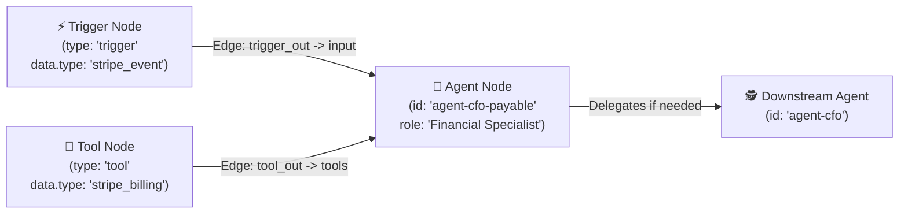
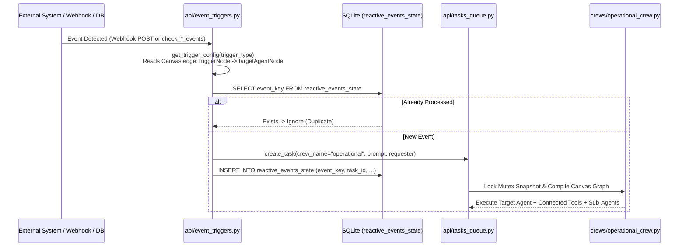

# 🛠️ AI Board — Developer Guide for Custom Tools (*Ferramentas*) & Reactive Triggers (*Gatilhos*)

[**⬅️ Back to Main README (`README.md`)**](../README.md) · [**🇧🇷 Português (`docs/README.pt-BR.md`)**](README.pt-BR.md) · [**🇪🇸 Español (`docs/README.es.md`)**](README.es.md) · [**⚙️ Configuration & Deploy Guide (`docs/CONFIGURATION_AND_DEPLOY.md`)**](CONFIGURATION_AND_DEPLOY.md)

---

## 📖 Table of Contents

- [Architecture Overview: How Tools & Triggers Interact on the Canvas](#-architecture-overview-how-tools--triggers-interact-on-the-canvas)
- [Part 1: How to Develop Custom Ferramentas (Tools)](#-part-1-how-to-develop-custom-ferramentas-tools)
  - [1.1 Architecture of a CrewAI `BaseTool` in AI Board](#11-architecture-of-a-crewai-basetool-in-ai-board)
  - [1.2 Public Tools (`tools/`) vs. Private Company Plugins (`custom_tools/`)](#12-public-tools-tools-vs-private-company-plugins-custom_tools)
  - [1.3 Step 1: Writing the Tool Class (Complete Copy-Pasteable Example)](#13-step-1-writing-the-tool-class-complete-copy-pasteable-example)
  - [1.4 Step 2: Registering the Tool in `crews/operational_crew.py`](#14-step-2-registering-the-tool-in-crewsoperational_crewpy)
  - [1.5 Step 3: Adding Live Health Diagnostics in `api/tool_diagnostics.py`](#15-step-3-adding-live-health-diagnostics-in-apitool_diagnosticspy)
  - [1.6 Step 4: Adding the Tool to the Visual Studio Catalog (`CatalogModal.jsx` & `PlatformLogo.jsx`)](#16-step-4-adding-the-tool-to-the-visual-studio-catalog-catalogmodaljsx--platformlogojsx)
- [Part 2: How to Develop Custom Gatilhos (Reactive Event Triggers)](#-part-2-how-to-develop-custom-gatilhos-reactive-event-triggers)
  - [2.1 Architecture of Reactive Triggers in AI Board](#21-architecture-of-reactive-triggers-in-ai-board)
  - [2.2 How Canvas Topology Routing Works (`trigger -> agent` Edge Compilation)](#22-how-canvas-topology-routing-works-trigger---agent-edge-compilation)
  - [2.3 Tutorial A: Creating a New Webhook Gatilho (e.g., Stripe / ERP / Custom Webhook)](#23-tutorial-a-creating-a-new-webhook-gatilho-eg-stripe--erp--custom-webhook)
  - [2.4 Tutorial B: Creating a New Polling / Watcher Gatilho with SQLite Deduplication](#24-tutorial-b-creating-a-new-polling--watcher-gatilho-with-sqlite-deduplication)
  - [2.5 Tutorial C: Scheduled Cron Triggers (`_cron_scheduler_loop` in `api/tasks_queue.py`)](#25-tutorial-c-scheduled-cron-triggers-_cron_scheduler_loop-in-apitasks_queuepy)
  - [2.6 Step-by-Step: Registering Your Trigger in the Visual Catalog & Diagnostics](#26-step-by-step-registering-your-trigger-in-the-visual-catalog--diagnostics)

---

## 🧩 Architecture Overview: How Tools & Triggers Interact on the Canvas

In **AI Board (`aiboard`)**, the visual topology stored in SQLite (`canvas_topology` table inside `data/tasks.db`) consists of three core node types connected by directed edges (`edges`):

1. **Trigger Nodes (`type: "trigger"`)**: Entry points that listen for external events (HTTP Webhooks, Chatwoot messages, FreeScout tickets, Telegram commands, or Cron schedules). An edge from a `trigger` node to an `agent` node (`source: "trig-..." -> target: "agent-..."`) tells AI Board which agent is responsible for handling that event.
2. **Agent Nodes (`type: "agent"`)**: C-Level directors or specialist agents (`role`, `goal`, `backstory`, `model`, `scheduledTasks`). Edges between agents (`agent A -> agent B`) grant delegation permissions (`allow_delegation=True`).
3. **Tool Nodes (`type: "tool"`)**: Capabilities wired to specific agents (`tool -> agent` or `agent -> tool`). When `create_operational_crew()` in [`crews/operational_crew.py`](../crews/operational_crew.py) compiles a run, each agent receives **only** the `BaseTool` instances corresponding to the tool nodes connected to it on the canvas (plus its built-in Frugal AI workspace tools).



---

## 🔧 Part 1: How to Develop Custom Ferramentas (Tools)

### 1.1 Architecture of a CrewAI `BaseTool` in AI Board

Every tool in AI Board inherits from `crewai.tools.BaseTool` and defines four essential attributes:

- `name: str` — Unique snake_case identifier visible to the LLM during tool calling (e.g., `"hubspot_crm_lookup"`).
- `description: str` — Clear, actionable instructions telling the agent **when** and **how** to call the tool, and what data it returns.
- `args_schema: Type[BaseModel]` — A Pydantic `BaseModel` defining typed parameters and `Field(..., description=...)` metadata so Gemini generates valid JSON tool arguments.
- `_run(self, **kwargs) -> str` — Synchronous execution method that performs the API query, database lookup, or Playwright automation and returns a structured Markdown or JSON string.

---

### 1.2 Public Tools (`tools/`) vs. Private Company Plugins (`custom_tools/`)

AI Board supports two directories for tool modules:

| Feature | 🌍 Public Universal Tools (`tools/`) | 🔒 Private Company Plugins (`custom_tools/`) |
| :--- | :--- | :--- |
| **Git Tracking** | Tracked in the public Git repository | **Gitignored** (`.gitignore` ignores `custom_tools/*.py` except `__init__.py` & `example_custom_tool.py`) |
| **Intended Use** | Universal open-source connectors (Gmail, Google Drive, Chatwoot, FreeScout, Notion, Meta/Google Ads, Telegram, Generic MCP) | Proprietary ERPs, internal company databases, regional delivery marketplaces, Open Finance credentials, custom scrapers |
| **Discovery** | Always visible in `PUBLIC_TOOL_CATALOG` | Dynamically detected at runtime via `_has_custom_module()` in `api/tool_diagnostics.py` and exposed in `/api/settings -> installed_tools` |
| **`git pull` Safety** | Updated by upstream commits | Never overwritten or conflicted when pulling new AI Board releases |

> **Best Practice:** If you are building a proprietary connector for your company (e.g., SAP, Oracle, Totvs, internal REST API, or custom ERP), place the file in `custom_tools/`. If you are contributing a universal open-source integration back to the community, place it in `tools/`.

---

### 1.3 Step 1: Writing the Tool Class (Complete Copy-Pasteable Example)

You can start from [`custom_tools/example_custom_tool.py`](../custom_tools/example_custom_tool.py). Below is a complete, production-ready example of a custom tool (`custom_tools/hubspot_crm_tools.py`) that includes a reusable client class, health check method, Pydantic input schema, and `BaseTool` implementation:

```python
"""Custom HubSpot CRM Tool for AI Board (aiboard).

File location: custom_tools/hubspot_crm_tools.py
"""
import os
import time
import logging
import requests
from typing import Type, Optional, Dict, Any
from pydantic import BaseModel, Field

try:
    from crewai.tools import BaseTool
except ImportError:
    class BaseTool:
        def __init__(self, **kwargs):
            pass

        def run(self, **kwargs):
            return self._run(**kwargs)

logger = logging.getLogger("hubspot_crm_tools")


class HubSpotClient:
    """Reusable HTTP client with built-in health diagnostics."""

    def __init__(self, api_key: Optional[str] = None):
        self.api_key = (api_key or os.getenv("HUBSPOT_ACCESS_TOKEN") or "").strip()
        self.base_url = "https://api.hubapi.com"

    @property
    def headers(self) -> Dict[str, str]:
        return {
            "Authorization": f"Bearer {self.api_key}",
            "Content-Type": "application/json",
        }

    def test_connection(self) -> Dict[str, Any]:
        """Used by api/tool_diagnostics.py to display live status on the Canvas."""
        start = time.time()
        if not self.api_key:
            return {
                "status": "warning",
                "status_label": "Token Pending",
                "is_configured": False,
                "latency_ms": 1,
                "details": "Configure HUBSPOT_ACCESS_TOKEN in .env or node settings.",
            }
        try:
            resp = requests.get(
                f"{self.base_url}/crm/v3/objects/contacts",
                params={"limit": 1},
                headers=self.headers,
                timeout=6,
            )
            latency = max(1, int((time.time() - start) * 1000))
            if resp.status_code == 200:
                return {
                    "status": "online",
                    "status_label": "Online (HubSpot API)",
                    "is_configured": True,
                    "latency_ms": latency,
                    "details": "Authenticated with HubSpot CRM v3 API.",
                }
            return {
                "status": "warning",
                "status_label": f"HTTP {resp.status_code}",
                "is_configured": True,
                "latency_ms": latency,
                "details": f"HubSpot API returned HTTP {resp.status_code}: {resp.text[:120]}",
            }
        except Exception as e:
            latency = max(1, int((time.time() - start) * 1000))
            return {
                "status": "offline",
                "status_label": "Unreachable",
                "is_configured": False,
                "latency_ms": latency,
                "details": f"Connection error: {str(e)[:120]}",
            }


class HubSpotDealSearchInput(BaseModel):
    query: str = Field(
        ...,
        description="Company name, deal title, or contact email to search in HubSpot CRM."
    )
    limit: Optional[int] = Field(
        5,
        description="Maximum number of deals/contacts to return (default: 5)."
    )


class HubSpotCRMTool(BaseTool):
    name: str = "hubspot_crm_search"
    description: str = (
        "Searches deals and contacts in HubSpot CRM by company name, deal title, or email. "
        "Use this tool whenever an executive or sales agent needs pipeline status, deal amounts, or customer contact details."
    )
    args_schema: Type[BaseModel] = HubSpotDealSearchInput
    api_key: Optional[str] = None

    def _run(self, query: str, limit: int = 5) -> str:
        client = HubSpotClient(api_key=self.api_key)
        if not client.api_key:
            return "❌ Error: HUBSPOT_ACCESS_TOKEN is not configured in the environment."

        try:
            resp = requests.post(
                f"{client.base_url}/crm/v3/objects/deals/search",
                headers=client.headers,
                json={
                    "query": query,
                    "limit": min(int(limit or 5), 20),
                    "properties": ["dealname", "amount", "dealstage", "closedate"],
                },
                timeout=10,
            )
            if resp.status_code != 200:
                return f"⚠️ HubSpot API HTTP {resp.status_code}: {resp.text[:300]}"

            results = resp.json().get("results", [])
            if not results:
                return f"ℹ️ No deals found in HubSpot matching query '{query}'."

            lines = [f"### 📊 HubSpot CRM Deals matching `{query}` ({len(results)} found):"]
            for d in results:
                props = d.get("properties", {})
                name = props.get("dealname", "Untitled")
                amount = props.get("amount") or "0.00"
                stage = props.get("dealstage", "unknown")
                closedate = props.get("closedate", "N/A")
                lines.append(f"- **{name}** (ID: `{d.get('id')}`) — Amount: **${amount}** | Stage: `{stage}` | Close Date: `{closedate}`")
            return "\n".join(lines)
        except Exception as e:
            logger.error(f"HubSpotCRMTool error: {e}")
            return f"❌ Failed to query HubSpot CRM: {str(e)}"
```

---

### 1.4 Step 2: Registering the Tool in `crews/operational_crew.py`

Open [`crews/operational_crew.py`](../crews/operational_crew.py) and register your tool in two places:

1. **Import with graceful fallback** at the top of `crews/operational_crew.py` (so the platform still boots cleanly even if the private module is not installed on another machine):
   ```python
   try:
       from custom_tools.hubspot_crm_tools import HubSpotCRMTool
   except ImportError:
       try:
           from tools.hubspot_crm_tools import HubSpotCRMTool
       except ImportError:
           HubSpotCRMTool = None
   ```

2. **Map the Canvas `tool_type` inside `instantiate_mcp_tools_by_type(tool_type: str, custom_data: Optional[Dict] = None)`**:
   ```python
   elif t in ("hubspot", "hubspot_crm"):
       if HubSpotCRMTool is not None:
           hs_tool = HubSpotCRMTool()
           if custom_data and custom_data.get("apiKey"):
               hs_tool.api_key = custom_data.get("apiKey")
           tools.append(hs_tool)
   ```

Now, whenever an admin drags a tool node with `data.type = "hubspot"` onto the React Flow canvas and connects it to an Agent node, `create_operational_crew()` will automatically instantiate `HubSpotCRMTool` and pass it to that `Agent(tools=...)`!

---

### 1.5 Step 3: Adding Live Health Diagnostics in `api/tool_diagnostics.py`

To make your tool appear as **Installed** in the catalog and report live latency/health badges (`Online`, `Warning`, `Offline`) on the Visual Studio Canvas and in the Settings Microservices table, edit [`api/tool_diagnostics.py`](../api/tool_diagnostics.py):

1. **Register the module in `get_installed_catalog_items()`**:
   ```python
   def get_installed_catalog_items() -> Dict[str, List[str]]:
       installed_tools: List[str] = [
           "notion", "gmail", "drive", "chat", "freescout",
           "meta_ads", "google_ads", "url", "generic_mcp", "telegram", "whatsapp",
       ]
       # ...
       if _has_custom_module("hubspot_crm_tools"):
           installed_tools.append("hubspot")
   ```

2. **Add the health check helper function**:
   ```python
   def _check_hubspot_health(data: Optional[Dict[str, Any]] = None) -> Dict[str, Any]:
       try:
           try:
               from custom_tools.hubspot_crm_tools import HubSpotClient
           except ImportError:
               from tools.hubspot_crm_tools import HubSpotClient
           d = data or {}
           client = HubSpotClient(api_key=d.get("apiKey") or d.get("hubspotApiKey"))
           return client.test_connection()
       except Exception as e:
           return {
               "status": "warning",
               "status_label": "Connector Error",
               "is_configured": False,
               "latency_ms": 0,
               "details": f"HubSpot diagnostic failed: {str(e)[:100]}",
           }
   ```

3. **Route the tool ID/type in `test_tool_health(tool_id: str, tool_data: Dict[str, Any] = None)` and `get_all_tools_health()`**:
   ```python
   # Inside test_tool_health():
   elif "hubspot" in tid or "hubspot" in tool_type or "hubspot" in label:
       return _check_hubspot_health(data)

   # Inside get_all_tools_health():
   if "hubspot" in inst_tools:
       tools_to_check["tool-hubspot"] = ("tool-hubspot", {"toolType": "hubspot"})
   ```

---

### 1.6 Step 4: Adding the Tool to the Visual Studio Catalog (`CatalogModal.jsx` & `PlatformLogo.jsx`)

1. **Add the catalog entry in [`frontend/src/components/CatalogModal.jsx`](../frontend/src/components/CatalogModal.jsx)**:
   - If it is a **Public Tool**, add `'hubspot'` to `PUBLIC_TOOL_IDS` and `PUBLIC_TOOL_CATALOG`.
   - If it is a **Private Plugin (`custom_tools/`)**, add `'hubspot'` to `PRIVATE_TOOL_IDS` and `PRIVATE_TOOL_CATALOG` with localized names and descriptions (`name`, `name_en`, `name_es`, `desc`, `desc_en`, `desc_es`):
   ```javascript
   {
     id: 'hubspot',
     name: 'HubSpot CRM',
     name_en: 'HubSpot CRM',
     name_es: 'HubSpot CRM',
     category: 'Comercial & CRM',
     category_en: 'Sales & CRM',
     category_es: 'Ventas y CRM',
     desc: 'Consulta de pipeline de vendas, negócios (deals) e contatos no HubSpot CRM.',
     desc_en: 'Query sales pipeline, deals, and contacts in HubSpot CRM.',
     desc_es: 'Consulta del pipeline de ventas, negocios y contactos en HubSpot CRM.',
     type: 'hubspot',
     itemKind: 'tool',
     isPublic: false
   }
   ```

2. **Add the brand icon/logo in [`frontend/src/components/PlatformLogo.jsx`](../frontend/src/components/PlatformLogo.jsx)** inside `LOGO_MAP`:
   ```javascript
   hubspot: {
     domain: 'hubspot.com',
     fallbackIcon: Target,
     bgColor: 'bg-orange-50',
     color: '#FF7A59',
     logoUrl: 'https://www.hubspot.com/hubfs/HubSpot_Logos/HubSpot-Inversed-Favicon.png'
   },
   ```

---

## ⚡ Part 2: How to Develop Custom Gatilhos (Reactive Event Triggers)

### 2.1 Architecture of Reactive Triggers in AI Board

Reactive Triggers (`api/event_triggers.py` and `api/tasks_queue.py`) allow AI Board agents to act **proactively** without waiting for a human to type in the chat console. AI Board supports three trigger execution models:

| Trigger Model | Mechanism | Primary Files | Deduplication & Safeguards |
| :--- | :--- | :--- | :--- |
| **1. Webhook Triggers** | External services send an HTTP `POST` request to FastAPI (`/api/webhooks/<source>` or `/api/webhooks/custom/<event_key>`). | `api/main.py`<br/>`api/event_triggers.py` | Deduplicated via `reactive_events_state` (`event_key` PRIMARY KEY) + optional `X-Webhook-Secret` token & keyword filtering |
| **2. Polling / Reactive Watcher Triggers** | Periodic scan invoked via `POST /api/events/scan-now` or scheduled CRON (`run_event_loop_iteration()`) querying databases/APIs (Chatwoot Postgres, FreeScout MariaDB, ERP, etc.). | `api/event_triggers.py` | Deduplicated via `reactive_events_state` SQLite table + Chatwoot Human Takeover guard (`chatwoot_human_takeover`) |
| **3. Scheduled Cron Triggers** | Background daemon thread (`_cron_scheduler_loop`) evaluating 5-field cron expressions (`m h dom mon dow`) attached to agent nodes (`scheduledTasks`). | `api/tasks_queue.py` | Per-minute tick guard (`_executed_cron_ticks`), master `cron_scheduler_enabled` toggle, and Zero-Token deterministic fast-paths |

---

### 2.2 How Canvas Topology Routing Works (`trigger -> agent` Edge Compilation)

When a reactive trigger fires, how does AI Board know **which agent** on the React Flow canvas should execute the task?

1. **Resolution via `get_trigger_config()` and `get_target_agent_for_trigger()` (`api/event_triggers.py`)**:
   - The trigger engine loads the current topology from `get_canvas_topology()`.
   - It locates the `trigger` node matching either `node["id"] == trigger_id_or_type` or `node["data"]["type"] == trigger_id_or_type`.
   - It scans `topo["edges"]` for an outgoing edge where `edge["source"] == matching_node["id"]`.
   - The `edge["target"]` is extracted as `config["target_agent"]` (falling back to `fallback_agent_id` if unconnected).
   ```python
   for e in edges:
       if e.get("source") == nid and e.get("target"):
           config["target_agent"] = e.get("target")
           break
   ```

2. **Task Enqueueing & Graph Compilation (`dispatch_reactive_event()`)**:
   - `dispatch_reactive_event()` checks the SQLite `reactive_events_state` table to confirm `event["key"]` has never been processed before.
   - It calls `create_task()` in `api/tasks_queue.py`, which acquires the `execution_mutex` snapshot and invokes `create_operational_crew()` in `crews/operational_crew.py`.
   - Inside `create_operational_crew()`, the target agent receives all tools connected to its node on the canvas and can delegate to any downstream sub-agents connected via `agent -> agent` edges!



---

### 2.3 Tutorial A: Creating a New Webhook Gatilho (e.g., Stripe / ERP / Custom Webhook)

Suppose you want to create a dedicated **Stripe Billing Webhook Trigger** (`stripe_event`) that fires whenever an invoice payment fails (`invoice.payment_failed`) and dispatches the connected financial agent on the Canvas.

#### Step 1: Write the Webhook Ingestion Function in `api/event_triggers.py`

Add the handler function in [`api/event_triggers.py`](../api/event_triggers.py) using `get_trigger_config()` and `dispatch_reactive_event()`:

```python
def ingest_stripe_webhook_event(payload: Dict[str, Any], signature: Optional[str] = None) -> Dict[str, Any]:
    """Processes incoming Stripe webhooks, checks canvas trigger filters, and dispatches the connected agent."""
    event_id = str(payload.get("id") or uuid.uuid4())
    event_type = str(payload.get("type") or "unknown").strip()
    data_obj = (payload.get("data") or {}).get("object") or {}

    customer_email = data_obj.get("customer_email") or data_obj.get("customer_name") or "Unknown Customer"
    amount_due = (data_obj.get("amount_due") or 0) / 100.0
    currency = str(data_obj.get("currency") or "usd").upper()
    invoice_id = data_obj.get("id") or "N/A"

    # 1. Resolve which Agent is connected to the 'stripe_event' trigger node on the Canvas
    trig_cfg = get_trigger_config("stripe_event", fallback_agent_id="agent-cfo-payable")
    target_agent = trig_cfg.get("target_agent", "agent-cfo-payable")

    # 2. Build the structured Zero-Click Resolution prompt for the agent
    prompt = (
        f"[🚨 STRIPE WEBHOOK TRIGGER FIRED — {event_type.upper()}]\n"
        f"• Event ID: `{event_id}` | Invoice ID: `{invoice_id}`\n"
        f"• Customer: {customer_email}\n"
        f"• Amount: {currency} {amount_due:,.2f}\n\n"
        f"🛠️ [EXECUTIVE INSTRUCTION]:\n"
        f"1) Cross-check invoice `{invoice_id}` in the financial system.\n"
        f"2) Prepare a payment recovery notice or alert the CFO with the exact diagnostic."
    )

    # 3. Dispatch with automatic SQLite deduplication via reactive_events_state
    dedup_key = f"stripe_wh_{event_id}"
    task_id = dispatch_reactive_event({
        "key": dedup_key,
        "source": "stripe",
        "entity_id": str(invoice_id),
        "trigger_type": "stripe_event",
        "fallback_agent": target_agent,
        "prompt": prompt,
        "details": f"[Stripe] {event_type} - Invoice {invoice_id} ({currency} {amount_due:,.2f})"
    })

    return {
        "status": "dispatched" if task_id else "duplicate",
        "event_id": event_id,
        "task_id": task_id,
        "target_agent": target_agent,
    }
```

#### Step 2: Expose the FastAPI Webhook Route in `api/main.py`

Add the endpoint in [`api/main.py`](../api/main.py):

```python
@app.post("/api/webhooks/stripe")
async def api_webhook_stripe(request: Request, payload: Dict[str, Any] = Body(default={})):
    """Official Stripe Webhook receiver."""
    if not payload or payload.get("type") == "ping":
        return {"status": "ok", "message": "Stripe Webhook Ping acknowledged"}
    sig = request.headers.get("Stripe-Signature")
    try:
        from api.event_triggers import ingest_stripe_webhook_event
        res = ingest_stripe_webhook_event(payload, signature=sig)
        return {"status": "ok", "result": res}
    except Exception as e:
        logger.error(f"Stripe webhook error: {e}")
        return {"status": "error", "message": str(e)}
```

> **💡 Tip — Built-in Zero-Code Custom Webhook (`trig_custom`)**:
> For many integrations, you don't even need to write Python code! Simply drag the **"Custom REST Trigger" (`trig_custom`)** node onto the Canvas, set an `eventKey` (e.g., `erp_alert`), optional `secretToken`, `filterKeywords`, and `promptTemplate`, and POST JSON payloads directly to:
> `POST /api/webhooks/custom/erp_alert` (with header `X-Webhook-Secret: <your_token>`).

---

### 2.4 Tutorial B: Creating a New Polling / Watcher Gatilho with SQLite Deduplication

When an external system (such as a database, legacy ERP, or helpdesk) cannot push webhooks, you can create a **Polling / Reactive Watcher Trigger** in [`api/event_triggers.py`](../api/event_triggers.py).

#### How SQLite Deduplication Works in `api/event_triggers.py`

AI Board stores every processed event key in the `reactive_events_state` SQLite table (`data/tasks.db`):

```sql
CREATE TABLE IF NOT EXISTS reactive_events_state (
    event_key TEXT PRIMARY KEY,
    source TEXT NOT NULL,
    entity_id TEXT NOT NULL,
    detected_at REAL NOT NULL,
    task_id TEXT,
    details TEXT,
    status TEXT DEFAULT 'dispatched'
)
```

You can also use helper functions `_is_event_processed(event_key)` / `_mark_event_processed(...)` or simply pass your event dictionary to `dispatch_reactive_event(event)`, which atomically checks `SELECT event_key FROM reactive_events_state WHERE event_key = ?` before creating a task and inserts the `event_key` once dispatched.

#### Step 1: Write the Watcher Function in `api/event_triggers.py`

```python
def _is_event_processed(event_key: str) -> bool:
    """Checks if an event_key has already been dispatched in reactive_events_state."""
    with get_db_connection() as conn:
        cur = conn.cursor()
        cur.execute("SELECT 1 FROM reactive_events_state WHERE event_key = ?", (event_key,))
        return cur.fetchone() is not None


def _mark_event_processed(event_key: str, source: str, entity_id: str, task_id: str, details: str = "") -> None:
    """Records a processed event_key in SQLite to prevent duplicate agent executions."""
    with get_db_connection() as conn:
        conn.execute(
            """
            INSERT OR IGNORE INTO reactive_events_state
            (event_key, source, entity_id, detected_at, task_id, details, status)
            VALUES (?, ?, ?, ?, ?, ?, 'dispatched')
            """,
            (event_key, source, entity_id, time.time(), task_id, details),
        )
        conn.commit()


def check_low_stock_erp_events() -> List[Dict[str, Any]]:
    """Polls the local or remote database for critical stockouts and returns reactive event dicts."""
    events: List[Dict[str, Any]] = []
    if not os.path.exists(ANALYTICS_DB_PATH):
        return events

    # Resolve target agent connected to the 'low_stock_event' trigger node on the Canvas
    trig_cfg = get_trigger_config("low_stock_event", fallback_agent_id="agent-coo-stock")
    if trig_cfg.get("trigger_mode") == "webhook_only":
        return events

    today_str = datetime.now(BRT).strftime("%Y-%m-%d")

    try:
        with sqlite3.connect(ANALYTICS_DB_PATH, timeout=5) as conn:
            conn.row_factory = sqlite3.Row
            cur = conn.cursor()
            cur.execute("""
                SELECT item_id, item_name, current_qty, min_qty
                FROM inventory_items
                WHERE current_qty <= min_qty
                LIMIT 10
            """)
            for row in cur.fetchall():
                item_id = str(row["item_id"])
                # Deduplicate per item per day
                ev_key = f"low_stock_{item_id}_{today_str}"
                if _is_event_processed(ev_key):
                    continue

                prompt = (
                    f"[🚨 LOW STOCK REACTIVE TRIGGER]\n"
                    f"• Item: {row['item_name']} (ID: `{item_id}`)\n"
                    f"• Current Balance: {row['current_qty']} | Minimum Threshold: {row['min_qty']}\n"
                    f"• Instruction: Check supplier lead times and draft a purchase order immediately."
                )
                events.append({
                    "key": ev_key,
                    "source": "erp_inventory",
                    "entity_id": item_id,
                    "trigger_type": "low_stock_event",
                    "fallback_agent": trig_cfg.get("target_agent", "agent-coo-stock"),
                    "prompt": prompt,
                    "details": f"Stockout alert: {row['item_name']} ({row['current_qty']}/{row['min_qty']})",
                })
    except Exception as e:
        logger.error(f"Error in check_low_stock_erp_events: {e}")

    return events
```

#### Step 2: Register the Watcher in `run_event_loop_iteration()` (`api/event_triggers.py`)

Add your watcher call inside `run_event_loop_iteration()` in [`api/event_triggers.py`](../api/event_triggers.py):

```python
    # 6. Low Stock Watcher Trigger
    try:
        stock_evs = check_low_stock_erp_events()
        checked_events.extend(stock_evs)
    except Exception as e:
        logger.error(f"Error in low stock trigger: {e}")
```

Every event returned in `checked_events` is automatically passed to `dispatch_reactive_event(ev)`, which verifies `reactive_events_state`, marks the `event_key` as processed, and enqueues the task for the connected Canvas agent.

---

### 2.5 Tutorial C: Scheduled Cron Triggers (`_cron_scheduler_loop` in `api/tasks_queue.py`)

In addition to event-driven triggers, any Agent node on the Canvas can hold an array of `scheduledTasks` (`id`, `title`, `cron`, `frequency`, `instruction`, `active`).

- **How it works**:
  - `start_cron_scheduler()` in [`api/tasks_queue.py`](../api/tasks_queue.py) starts the daemon thread `_cron_scheduler_loop()`.
  - Every 20 seconds (when `cron_scheduler_enabled` is `true` in `/api/settings`), it evaluates all active `scheduledTasks` across all agent nodes using `is_cron_due(cron_expr, now_dt)` (supporting standard 5-field cron syntax: `minute hour day month day_of_week`, ranges `1-5`, lists `1,3,5`, and steps `*/15`).
  - It prevents duplicate executions within the same minute using `_executed_cron_ticks`.
  - You can also manage scheduled tasks via REST API (`GET /api/scheduled-tasks`, `POST /api/scheduled-tasks`, `DELETE /api/scheduled-tasks/{task_id}`, `POST /api/scheduled-tasks/{task_id}/run`) or set `agent_id="auto"` to let `auto_route_agent_for_instruction()` assign the task to the best specialist agent on the canvas.

---

### 2.6 Step-by-Step: Registering Your Trigger in the Visual Catalog & Diagnostics

To make your new trigger selectable in the Visual Studio **Catalog Modal** and monitored by the live health diagnostics:

1. **Add the Trigger to [`frontend/src/components/CatalogModal.jsx`](../frontend/src/components/CatalogModal.jsx)**:
   - For a public trigger, add `'trig_stripe'` to `PUBLIC_TRIGGER_IDS` and `PUBLIC_TRIGGER_CATALOG`.
   - For a private company trigger, add `'trig_stripe'` to `PRIVATE_TRIGGER_IDS` and `PRIVATE_TRIGGER_CATALOG`:
   ```javascript
   {
     id: 'trig_stripe',
     name: 'Stripe Billing Webhook',
     name_en: 'Stripe Billing Webhook',
     name_es: 'Webhook de Stripe Billing',
     category: 'Financeiro & Pagamentos',
     category_en: 'Finance & Payments',
     category_es: 'Finanzas y Pagos',
     desc: 'Dispara em tempo real quando faturas falham ou pagamentos são confirmados no Stripe.',
     desc_en: 'Fires in real time when invoices fail or payments are confirmed in Stripe.',
     desc_es: 'Se activa en tiempo real cuando fallan facturas o se confirman pagos en Stripe.',
     type: 'stripe_event',
     itemKind: 'trigger',
     isPublic: true
   }
   ```

2. **Expose the Trigger in [`api/tool_diagnostics.py`](../api/tool_diagnostics.py)**:
   - Add `"trig_stripe"` to `installed_triggers` inside `get_installed_catalog_items()` (either unconditionally for public triggers or conditionally via `if _has_custom_module("stripe_tools"):` for private triggers).
   - Add a health check branch in `test_tool_health()`:
   ```python
   elif tid == "trig-stripe" or tool_type == "stripe_event":
       return {
           "status": "online",
           "status_label": "Webhook Ready",
           "is_configured": True,
           "latency_ms": 1,
           "details": "Endpoint POST /api/webhooks/stripe online and listening for events."
       }
   ```

3. **Test Your Trigger End-to-End**:
   ```bash
   curl -X POST http://localhost:8001/api/webhooks/stripe \
     -H "Content-Type: application/json" \
     -d '{
       "id": "evt_test_001",
       "type": "invoice.payment_failed",
       "data": {
         "object": {
           "id": "in_998877",
           "customer_email": "billing@client.com",
           "amount_due": 49900,
           "currency": "usd"
         }
       }
     }'
   ```
   Open the **Operational Chat Console** in AI Board to watch your target agent receive the event, invoke its connected tools, and stream its execution live!
